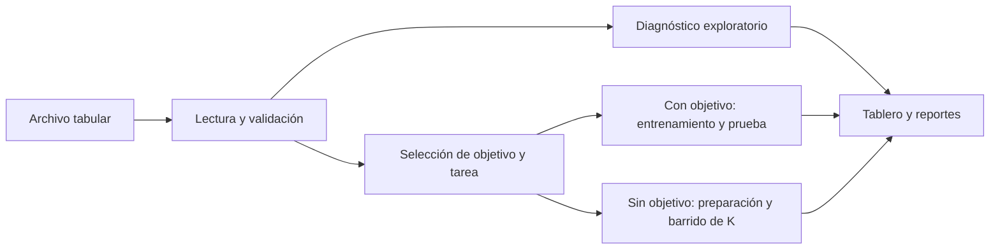

# Cuaderno de datos | Flujo y resultados con dos datasets reales

Probamos dos rutas de la misma aplicación. En acero, una columna con el tipo de defecto permite entrenar un clasificador y medir cuántos casos acierta en una reserva. En sismos, las cuatro columnas describen cada evento y K-Means busca grupos de observaciones parecidas. Los datos provienen de fuentes independientes y cada archivo se puede abrir sin conexión desde **Ejemplo local**.

| Archivo | Pregunta | Resultado principal |
|---|---|---|
| [`defectos_acero.csv`](../data/defectos_acero.csv) | ¿Qué tipo de defecto superficial indican su área y luminosidad? | CART acertó **99 de 104** casos de prueba. |
| [`sismos_profundos_pacifico.tsv`](../data/sismos_profundos_pacifico.tsv) | ¿Qué perfiles aparecen al agrupar sismos por ubicación, profundidad y magnitud? | El codo eligió **5 grupos**. La silueta media más alta se obtuvo con **6**. |

## 1. Cómo funciona la app

Desde la raíz del repositorio, con el entorno de Python activado según el [README](../README.md), iniciar el tablero con:

```bash
python -m streamlit run main.py
```

El panel lateral permite abrir un ejemplo local o subir un CSV, TSV o Parquet. Para archivos de texto, **Opciones de lectura** permite elegir el separador y ajustar el encabezado. **Variable objetivo** ofrece los modos **Automática**, **Elegir columna** y **Sin objetivo**.



| Paso | Qué se ve en el tablero | Qué hace el código |
|---|---|---|
| Lectura | Vista previa, cantidad de filas y columnas, y aviso si el archivo falla. | [`core/loader.py`](../core/loader.py) interpreta el archivo, comprueba que los encabezados sean únicos y valida que existan datos. [`interfaz/entrada.py`](../interfaz/entrada.py) conserva la lectura en sesión según el contenido y sus opciones. |
| Diagnóstico | **Resumen** muestra la tabla y una distribución. **Variables** presenta tipos, faltantes, cardinalidad y estadísticos. **Relaciones** muestra Pearson, Spearman, covarianza y una dispersión cuando hay un par válido. | [`core/eda.py`](../core/eda.py) analiza la tabla completa. [`evaluation/visualizer.py`](../evaluation/visualizer.py) anota y exporta los mapas de calor. El EDA describe el archivo y el entrenamiento calcula sus propias estadísticas de preparación. |
| Enrutamiento | Aparece **Modelo** si hay objetivo, o **Agrupamiento** con un aviso explicativo si falta una candidata clara. | [`core/loader.py`](../core/loader.py) busca nombres reconocibles y puede sugerir la última columna si contiene pocas categorías repetidas. La app permite corregir la sugerencia y la tarea. La magnitud del archivo sísmico se usa como una propiedad más del evento. |
| Ejecución y salida | El botón inicia el cálculo y la vista muestra las métricas y figuras. | [`interfaz/modelos.py`](../interfaz/modelos.py) llama al flujo elegido. [`interfaz/estado.py`](../interfaz/estado.py) gestiona qué resultado sigue vigente. [`evaluation/exportacion.py`](../evaluation/exportacion.py) guarda una carpeta por ejecución en `reports/`, con PNG a 300 DPI y archivos de datos. |

En el EDA, **Pearson** mide asociación lineal, **Spearman** compara el orden de los valores y la **covarianza** indica cómo varían juntas dos columnas en sus escalas originales. La regla IQR marca valores por debajo de `Q1 − 1,5 × IQR` o por encima de `Q3 + 1,5 × IQR`. Estas marcas sirven para inspeccionar observaciones, que se conservaron en las dos ejecuciones.

## 2. Acero | Clasificación supervisada

### Qué cargamos y qué hicimos

Cada fila describe un defecto superficial ya identificado. Conservamos las **518 observaciones** de tres clases del dataset original: **391 rayas tipo K**, **72 manchas** y **55 casos de suciedad**. De las variables originales usamos `LogOfAreas` como `log_area_px` y `Luminosity_Index` como `indice_luminosidad`. Los tres indicadores originales de defecto se combinaron en la etiqueta `clase`. Esta selección de dos predictores permite mostrar la superficie de decisión en los mismos ejes que se usan para entrenar. [Steel Plates Faults, Buscema, Terzi y Tastle, 2010](https://doi.org/10.24432/C5J88N) · [Copia utilizada](https://raw.githubusercontent.com/iamMPAI/Steel-plates-faults/main/stell-faults.csv) · [CC BY 4.0](https://creativecommons.org/licenses/by/4.0/)

1. En **Ejemplo local**, abrir `defectos_acero.csv` y mantener **Automática**. El tablero reconoce `clase` y selecciona **Clasificación**.
2. En **Variables** y **Relaciones**, revisar faltantes, distribución y dispersión. El archivo tiene cero faltantes. El área logarítmica y la luminosidad muestran asociación negativa (Pearson **−0,505**, Spearman **−0,417**). La luminosidad tiene **34** valores marcados por IQR, que conviene inspeccionar en su contexto.
3. En **Modelo → Árbol CART**, fijar la profundidad máxima en **3** y pulsar **Ejecutar análisis**. Revisar la matriz normalizada y la importancia de variables.
4. En **Modelo → Comparación**, mantener los seis clasificadores y pulsar **Comparar modelos**. Revisar la exactitud de CV, la exactitud de prueba y **Superficie de decisión**.

### Qué pasó detrás

- [`core/particion.py`](../core/particion.py) separó `clase` de los predictores y reservó aproximadamente el 20 % con semilla **42**. La estratificación conservó proporciones similares de las clases. Quedaron **414 filas de entrenamiento** y **104 de prueba**.
- [`flujo.py`](../flujo.py) entrenó [CART](../models/supervised/tree_models.py) con los dos predictores numéricos en su escala original. El árbol prueba cortes en una variable a la vez y elige los que más reducen la impureza de Gini ponderada de los grupos resultantes. La profundidad máxima limita cuántos cortes pueden aparecer en una ruta hasta una hoja.
- [`core/preprocessor.py`](../core/preprocessor.py) define la imputación numérica por mediana y la codificación de categorías cuando son predictores. En este archivo ambos predictores son numéricos y están completos. CART y Random Forest conservan sus escalas. Logística, k-NN, LVQ1 y DANN estandarizan los predictores numéricos.
- [`models/supervised/comparacion.py`](../models/supervised/comparacion.py) usa **cinco pliegues estratificados dentro de las 414 filas de entrenamiento**. En cada pliegue se ajusta el preprocesamiento con la porción de ajuste. La rejilla selecciona los parámetros por exactitud media de validación. Cada ajuste elegido se reentrena con las 414 filas y se evalúa sobre las mismas 104 filas reservadas.

### Resultados e interpretación

La exactitud del árbol de profundidad 3 fue **95,2 % (99/104)**. Predecir siempre la clase mayoritaria, **Raya K**, habría acertado **76,0 % (79/104)** en la misma reserva. Esta referencia ayuda a interpretar la exactitud cuando una clase concentra buena parte de los ejemplos.

| Clase real ↓ / Predicción → | Mancha | Raya K | Suciedad | Aciertos dentro de la clase |
|---|---:|---:|---:|---:|
| Mancha | **13** | 0 | 1 | 13/14 = 92,9 % |
| Raya K | 0 | **77** | 2 | 77/79 = 97,5 % |
| Suciedad | 0 | 2 | **9** | 9/11 = 81,8 % |

La tabla muestra conteos. El tablero divide cada fila por su total, de modo que la diagonal indica qué proporción de cada clase se reconoció. La confusión más visible está entre **raya tipo K y suciedad**: dos casos en cada dirección. Con solo 11 casos de suciedad en prueba, un acierto cambia su porcentaje en unos **9 puntos**. El árbol asignó **86,9 %** de su importancia por reducción de impureza al área logarítmica y **13,1 %** a la luminosidad. Es un resumen de los cortes que usó ese árbol.

| Familia | Idea del modelo | Parámetro elegido por CV | Exactitud CV | Exactitud en prueba |
|---|---|---|---:|---:|
| Logística | Combina ambos predictores en puntajes lineales por clase. | `C=10` | 91,8 % | 90,4 % |
| CART | Construye reglas por umbrales. | Profundidad sin límite explícito | 94,4 % | 95,2 % |
| Random Forest | Combina las predicciones de varios árboles. | Profundidad sin límite explícito | 95,2 % | 96,2 % |
| k-NN | Vota con vecinos euclidianos ponderados por distancia. | 5 vecinos | **96,4 %** | **96,2 %** |
| LVQ1 | Ajusta prototipos de clase por atracción y repulsión. | Tasa inicial 0,01 | 88,4 % | 85,6 % |
| DANN | Adapta la métrica a la distribución local de las clases. | 1 vecino para decidir | 95,9 % | 94,2 % |

El **CART de comparación** se seleccionó por validación cruzada. El **CART interactivo** se ejecutó con profundidad máxima 3. Ambos obtuvieron 95,2 % de exactitud en esta reserva. k-NN y Random Forest acertaron **100/104**, un caso más que el árbol interactivo. Ese margen es pequeño para sostener que una familia rendirá mejor en otras placas.

**Cómo leer las curvas.** ROC compara sensibilidad con tasa de falsos positivos al cambiar el umbral de una clase frente al resto. Precisión-recall muestra cuántas predicciones positivas son correctas al intentar recuperar más casos de esa clase. k-NN obtuvo un **AUC ROC micro de 0,998** al reunir las decisiones clase contra resto. El AUC mide el orden de los puntajes a través de umbrales. La exactitud de **96,2 %** se refiere a una única clase predicha por fila. La superficie de decisión usa k-NN porque tuvo la mayor exactitud de CV y colorea la clase que predice en cada combinación de área y luminosidad.

En **Curvas de aprendizaje**, el panel de tamaño muestral muestra cómo cambia el error de entrenamiento y validación al usar distintas cantidades de filas. Una brecha entre las curvas indica que el modelo acierta más en los datos con los que se ajustó. El segundo panel muestra cómo cambia el error medio de validación con el número de vecinos considerado en la búsqueda.

**Qué podemos hacer con el resultado.** Usar el árbol como referencia interpretable y examinar muestras donde se mezclan suciedad y rayas. Un flujo de inspección podría derivar casos dudosos a revisión humana. Para evaluar ese uso habría que probar en lotes nuevos, reunir más casos de las clases minoritarias y revisar qué errores son más costosos. El conjunto sólo incluye tres tipos de defectos ya detectados, así que la prueba cubre la clasificación de esos tipos.

## 3. Sismos | Agrupamiento no supervisado

### Qué cargamos y qué hicimos

Tomamos **250 eventos** de 2024 UTC, de magnitud **≥4,5** y profundidad **≥300 km**, entre 32°S y 12°S y hasta 15° a cada lado del meridiano de 180°. Cada fila contiene latitud, longitud relativa a 180°, profundidad en kilómetros y magnitud preferida del catálogo. Se centró la longitud alrededor de 180° para que dos eventos cercanos al meridiano no quedaran separados por un salto numérico. Por ejemplo, **179°E → −1°** y **179°O → +1°**. [USGS, catálogo ANSS ComCat](https://doi.org/10.5066/F7MS3QZH) · [Copia del catálogo profundo de Live Atlas](https://github.com/liveatlasearth/earthquake-catalogs) · [CC BY 4.0](https://creativecommons.org/licenses/by/4.0/)

1. Abrir `sismos_profundos_pacifico.tsv` y mantener **Automática**. Aparece el aviso y se habilita **Agrupamiento**.
2. En **Variables** y **Relaciones**, revisar las cuatro columnas. Hay cero faltantes. Las profundidades observadas van de **300,177 a 653,779 km** y las magnitudes de **4,5 a 5,9**. La profundidad y la magnitud tienen Pearson cercano a cero (**0,010**) en este recorte. La posición aporta información adicional para agrupar.
3. En **Agrupamiento**, mantener **K máximo a evaluar = 8** y pulsar **Evaluar grupos**. Cambiar entre **Codo**, **Siluetas** y **Proyección**.
4. Descargar **grupos por fila** para relacionar las asignaciones con las variables originales.

### Qué pasó detrás

1. [`models/unsupervised/kmeans_engine.py`](../models/unsupervised/kmeans_engine.py) prepara las cuatro columnas sobre los 250 eventos. Estandariza cada variable con `z = (x − media) / desviación estándar`, para que, por ejemplo, los kilómetros de profundidad no dominen la distancia por su escala numérica. Es una exploración del conjunto completo, por lo que no hay reserva de prueba.
2. K-Means alterna la asignación al centroide más cercano y el recálculo de cada centroide como media de su grupo. Lo ejecutamos para **K=2 a K=8**, con semilla **42**, usando **cinco reinicios** por cada combinación de K e inicialización. El inicio aleatorio toma puntos como centros iniciales. K-Means++ favorece puntos alejados de los centros ya elegidos. **K=1** se calcula como referencia de inercia.
3. Para cada K se conserva la inicialización con menor **inercia**, la suma de distancias cuadráticas de cada evento a su centroide. Para hallar el codo, el motor normaliza ambos ejes y busca el mayor alejamiento de la cuerda que une los extremos por debajo de esa recta. Si esa distancia es menor a **0,05**, elige la mayor silueta media entre los ajustes de menor inercia por K. En esta ejecución se aplicó el criterio del codo.
4. La **silueta** compara la distancia media al grupo propio con la distancia media al grupo alternativo más cercano. Valores cerca de 1 indican mejor separación individual, cerca de 0 sugieren frontera y negativos invitan a revisar la asignación. **Calinski–Harabasz (CHI)** favorece grupos compactos y separados con valores más altos. **Davies–Bouldin (DBI)** favorece valores más bajos.
5. Una vez ajustado el agrupamiento, **PCA** proyecta los eventos y sus centroides sobre los mismos dos ejes. En este archivo los dos componentes explican aproximadamente **60,5 %** de la varianza de las columnas estandarizadas. La figura muestra una vista parcial de los cuatro atributos utilizados por K-Means.

### Resultados e interpretación

La tabla muestra, por cada K, la fila de **menor inercia**. El archivo `metricas.csv` conserva ambas inicializaciones.

| K | Inercia | Silueta media | CHI | DBI |
|---:|---:|---:|---:|---:|
| 1 (referencia) | 1.000,00 | — | — | — |
| 2 | 771,29 | 0,288 | 73,54 | 1,470 |
| 3 | 600,11 | 0,303 | 82,29 | 1,065 |
| 4 | 444,51 | 0,355 | 102,47 | 0,905 |
| **5 (codo)** | **321,99** | **0,392** | **128,97** | **0,806** |
| 6 | 264,20 | 0,402 | 135,91 | 0,783 |
| 7 | 232,57 | 0,341 | 133,64 | 0,887 |
| 8 | 210,48 | 0,346 | 129,68 | 0,901 |

Pasar de **4 a 5** grupos baja la inercia en **122,52** unidades. Pasar de **5 a 6** la reduce en otras **57,79**. La aplicación seleccionó **K=5** por la curvatura de toda la serie. **K=6** obtuvo una silueta media ligeramente mayor, un CHI mayor y un DBI menor frente a K=5. Es un candidato para contrastar si interesa una partición más fina. La caída continua de la inercia es esperable al sumar centroides, por lo que su valor mínimo por sí solo favorece al K más alto probado.

| Grupo | Eventos | Latitud media | Longitud media desde 180° | Prof. media (km) | Magnitud media | Silueta media |
|---:|---:|---:|---:|---:|---:|---:|
| 1 | 22 | −20,23° | +1,15° | 564,2 | 5,49 | 0,437 |
| 2 | 86 | −24,34° | −0,07° | 528,9 | 4,64 | 0,404 |
| 3 | 109 | −19,29° | +1,53° | 564,4 | 4,63 | 0,411 |
| 4 | 29 | −22,24° | +2,03° | 368,5 | 4,73 | 0,223 |
| 5 | 4 | −13,91° | −9,78° | 557,8 | 4,55 | 0,624 |

Los dos grupos más numerosos, **2 y 3**, tienen magnitudes medias casi iguales y difieren en latitud y profundidad medias. El **grupo 1** tiene la mayor magnitud media. El **grupo 4** reúne los eventos relativamente menos profundos del recorte y muestra la menor silueta media. El **grupo 5** se distingue en la proyección y contiene solo cuatro sismos. Los números de grupo son identificadores del ajuste.

**Qué podemos hacer con el resultado.** Resumir perfiles, ubicar los eventos de cada grupo en un mapa y revisar observaciones de frontera con baja silueta. Se puede comparar K=5 y K=6 y repetir el análisis con otro año o con una escala distinta para las coordenadas. Los grupos son hipótesis exploratorias condicionadas por el recorte, las cuatro variables y la distancia euclidiana sobre los valores estandarizados. Atribuirlos a estructuras tectónicas requeriría evidencia geológica adicional. El ejercicio describe eventos observados y deja fuera el pronóstico y la evaluación del riesgo.

## 4. Cómo reproducir y usar los resultados

| Carpeta generada | Qué buscar |
|---|---|
| `reports/eda-*/` | Mapas de Pearson, Spearman y covarianza, y el gráfico de dispersión si existe un par válido. |
| `reports/cart-*/` | `evaluacion.png` con la matriz de confusión normalizada y `metricas.csv` con la exactitud. |
| `reports/comparacion-*/` | `metricas.csv`, `parametros.json`, `auc.csv`, `curvas_por_clase.csv` y los PNG de ROC, precisión-recall, aprendizaje y superficie de decisión. |
| `reports/kmeans-*/` | `metricas.csv`, `asignaciones.csv` y los PNG del codo, siluetas y proyección. |

Cada reporte de modelado incluye `configuracion.json` con la huella SHA-256 del archivo, opciones de lectura, semilla y parámetros generales de ejecución. En **Agrupamiento** se puede descargar `asignaciones.csv` directamente o buscarlo en la carpeta `reports/kmeans-*/` recién creada. Para reconstruir la tabla sísmica por grupo, abre una terminal desde la raíz del repositorio y sustituye la ruta de asignaciones por la de tu ejecución:

```python
from pathlib import Path

import pandas as pd

eventos = pd.read_csv("data/sismos_profundos_pacifico.tsv", sep="\t")
asignaciones = pd.read_csv(Path("reports/kmeans-REEMPLAZAR/asignaciones.csv"))
perfiles = eventos.join(asignaciones.set_index("Fila")[["Grupo", "Silueta"]])
por_grupo = perfiles.groupby("Grupo")
print(por_grupo.size().rename("Eventos"))
print(por_grupo.mean(numeric_only=True).round(3))
```

`Fila` corresponde al índice original de la observación, que empieza en cero para este TSV. Conserva el orden del archivo al hacer esa unión.

Para exponer el flujo completo, en acero conviene mostrar cómo la etiqueta produce una evaluación contra casos reservados y usar la matriz para explicar los errores. En sismos, el foco está en la decisión de K y en traducir los centroides y perfiles a latitud, profundidad y magnitud. Una ruta mide aciertos con etiquetas conocidas. La otra caracteriza similitudes usando las propiedades de los eventos.
