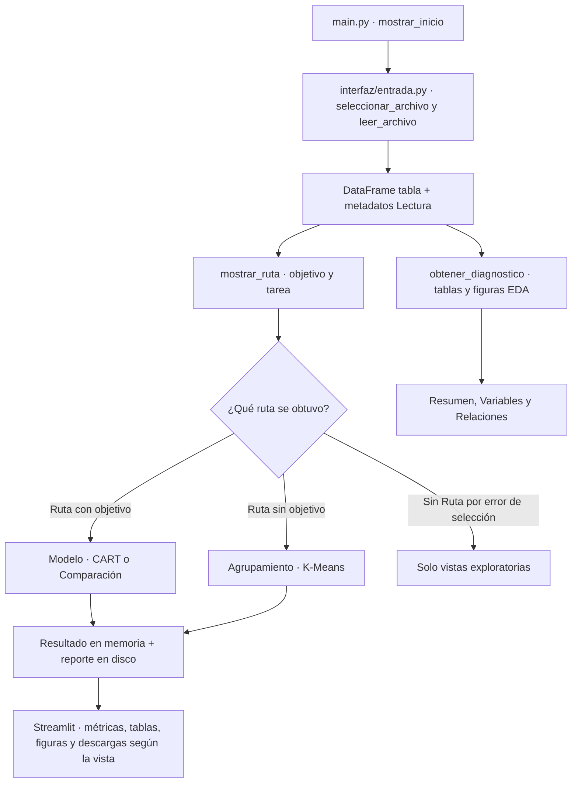
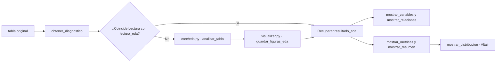
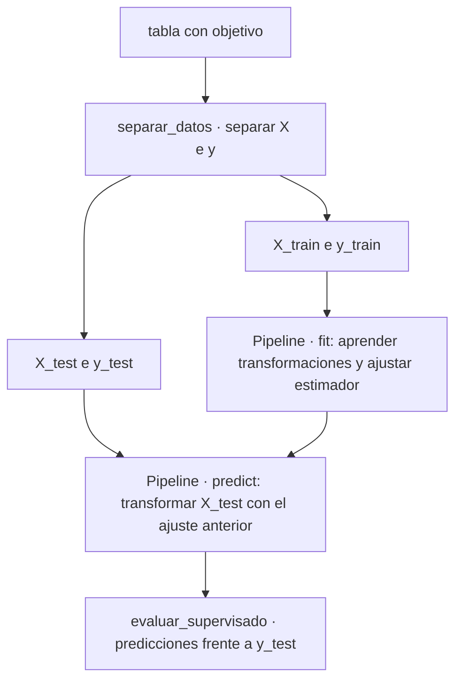
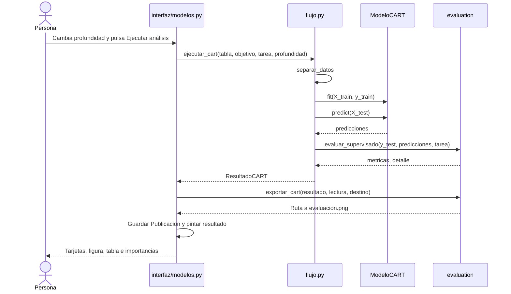
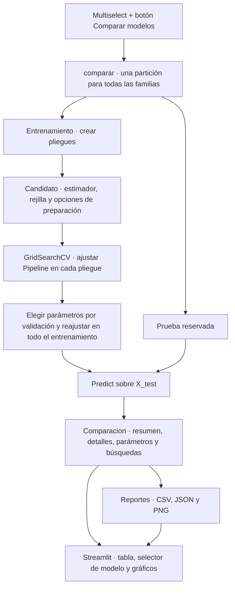
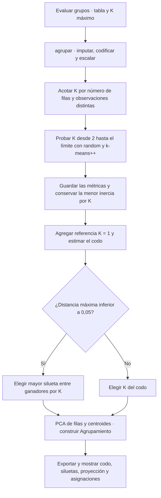
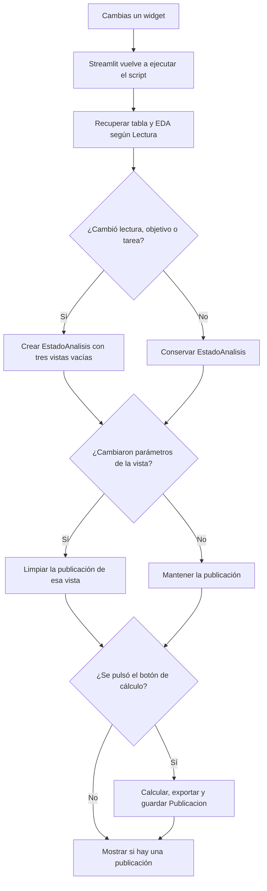

# Guía de código para la defensa

Esta guía sigue la versión `bf74ad3` de Cuaderno de datos. Los enlaces `#L` apuntan a líneas del código original. Después de editar, busca por nombre de función si la numeración se mueve. Los flujos también se explican en tablas para poder estudiarlos en un visor que muestre Mermaid como texto.

- [1. Cómo iniciar y recorrer la app](#1-cómo-iniciar-y-recorrer-la-app)
- [2. De los widgets al DataFrame](#2-de-los-widgets-al-dataframe)
- [3. Diagnóstico exploratorio](#3-diagnóstico-exploratorio)
- [4. Partición y preprocesamiento](#4-partición-y-preprocesamiento)
- [5. Árbol CART interactivo](#5-árbol-cart-interactivo)
- [6. Comparación supervisada](#6-comparación-supervisada)
- [7. Agrupamiento K-Means](#7-agrupamiento-k-means)
- [8. Streamlit, estado y reportes](#8-streamlit-estado-y-reportes)
- [9. Cambios para practicar](#9-cambios-para-practicar)
- [10. Depurar y comprobar cambios](#10-depurar-y-comprobar-cambios)
- [11. Preguntas de defensa](#11-preguntas-de-defensa)

## 1. Cómo iniciar y recorrer la app

Desde la raíz del repositorio, con el entorno de Python activado, ejecuta:

```bash
source .venv/bin/activate
python -m streamlit run main.py
```

Si necesitas crear el entorno, están los pasos en [README.md](../README.md). Abre la dirección que indica Streamlit. En **Ejemplo local**, elige `iris_petalos.csv` para seguir clasificación, `iris_medidas.tsv` para agrupamiento o `mediciones.tsv` con **Elegir columna → temperatura_c → Regresión** para seguir regresión. En las tres rutas, el EDA aparece después de cargar la tabla y el modelo se ejecuta al pulsar su botón.



### Qué representa cada dato

| Nombre en código | Tipo y contenido | Dónde seguirlo |
|---|---|---|
| `nombre, contenido` | Nombre y bytes del archivo, con independencia de su origen. | [interfaz/entrada.py](../interfaz/entrada.py#L29) |
| `tabla` | `DataFrame` original ya leído. Filas = observaciones. Columnas = variables, incluida la columna objetivo si existe. | [core/loader.py](../core/loader.py#L75) |
| `lectura` | `Lectura` con huella SHA-256, extensión, delimitador elegido y opción de encabezado. Identifica cómo se obtuvo la tabla. | [core/loader.py](../core/loader.py#L16) |
| `seleccion` / `ruta` | `Ruta` con objetivo, tarea y motivo. Una `Ruta` con objetivo `None` activa agrupamiento. Un retorno `None` de `mostrar_ruta` deja solo EDA. | [core/loader.py](../core/loader.py#L96) |
| `diagnostico, figuras` | `Diagnostico` con tablas EDA y diccionario de títulos a rutas de PNG. | [interfaz/exploracion.py](../interfaz/exploracion.py#L29) |
| `particion` | Cuatro conjuntos alineados de entrenamiento y prueba, más cantidad de filas sin objetivo. | [core/particion.py](../core/particion.py#L11) |
| `resultado` | `ResultadoCART`, `Comparacion` o `Agrupamiento`, según la vista. | [flujo.py](../flujo.py#L13), [comparacion.py](../models/supervised/comparacion.py#L88), [kmeans_engine.py](../models/unsupervised/kmeans_engine.py#L16) |
| `publicacion` | Par que conserva un resultado calculado y la ruta o rutas de sus archivos. | [interfaz/estado.py](../interfaz/estado.py#L14) |

## 2. De los widgets al DataFrame

Abre [main.py](../main.py#L19) y sigue `mostrar_inicio()`. La entrada efectiva está al final del archivo, en la línea 75. En las tablas, cada fila agrupa las líneas que realizan una misma operación.

| Líneas | Qué ocurre con los datos |
|---|---|
| [main.py · 21–32](../main.py#L21) | Configura la página y abre la barra lateral. `seleccionar_archivo(RAIZ / "data")` entrega nombre y bytes. Si se está esperando una subida, inicializa el estado vacío, muestra el mensaje y termina la ejecución. |
| [entrada.py · 29–37](../interfaz/entrada.py#L29) | `st.radio` decide el origen. El archivo subido entrega `archivo.getvalue()`. El ejemplo local se lee con `Path.read_bytes()`. Ambos entran al mismo lector. Los nombres de ejemplos se enumeran aquí. |
| [main.py · 33–38](../main.py#L33), [entrada.py · 55–68](../interfaz/entrada.py#L55) | `leer_archivo` calcula el SHA-256, lee los widgets de delimitador y encabezado para texto y arma `Lectura`. Si la identidad cambió, llama a `cargar_tabla` y actualiza `tabla_activa` y `lectura_tabla` en sesión. Si falla con `ValueError`, `main.py` muestra `st.error`. |
| [loader.py · 75–93](../core/loader.py#L75) | Selecciona el lector por extensión. Parquet usa `pd.read_parquet(BytesIO(...))`. TSV trae tabulación por defecto. Texto pasa por `_leer_texto`. Al final exige datos y nombres de columnas únicos y sin blancos en los extremos. |
| [loader.py · 25–53](../core/loader.py#L25) | `_leer_texto` decodifica UTF-8 con soporte de BOM y usa Latin-1 como alternativa. Puede inferir delimitador, comprueba el ancho de las filas y llama a `pd.read_csv`. Con encabezado desactivado asigna nombres `columna_1`, etc. |
| [main.py · 39–43](../main.py#L39), [entrada.py · 86–108](../interfaz/entrada.py#L86) | La interfaz recoge objetivo automático, manual o ausente. `seleccionar_ruta` devuelve la sugerencia. Si hay objetivo, otro `selectbox` permite corregir la tarea y `replace(ruta, tarea=tarea)` devuelve la selección final. |
| [loader.py · 122–139](../core/loader.py#L122) | En automático busca coincidencias con `NOMBRES_OBJETIVO`, ignorando mayúsculas. Con cero o varias candidatas deriva a agrupamiento. Con un objetivo válido, un tipo numérico salvo booleano sugiere regresión. Los demás tipos sugieren clasificación. Un objetivo vacío lanza error. |
| [main.py · 43–71](../main.py#L43) | Recupera el estado del análisis. Solicita el EDA, muestra indicadores y construye las pestañas. La presencia del objetivo elige entre las pantallas de Modelo y Agrupamiento. |

**Sigue un ejemplo en el editor.** Abre `iris_petalos.csv`, deja el objetivo automático y busca `clase` en [loader.py](../core/loader.py#L13). La coincidencia de nombre determina la candidata y el tipo de la serie sugiere clasificación. En `iris_medidas.tsv`, la ausencia de esos nombres activa Agrupamiento. Con `mediciones.tsv`, el objetivo solo se selecciona manualmente para el ejemplo de regresión.

## 3. Diagnóstico exploratorio



| Líneas | Qué ocurre con los datos |
|---|---|
| [exploracion.py · 29–38](../interfaz/exploracion.py#L29) | Usa la lectura como clave. Si cambió, invoca `analizar_tabla`, genera figuras y conserva ambos resultados. Ante un fallo de escritura muestra el error y `main.py` detiene el recorrido. Cambiar la tarea mantiene el EDA de la misma tabla. |
| [eda.py · 87–94](../core/eda.py#L87) | Selecciona columnas numéricas, trata infinitos como ausentes en el bloque numérico y llama a los auxiliares. Devuelve estructura, descriptivos, covarianza, Pearson, Spearman y pares Pearson. Las asociaciones usan las filas disponibles para cada par. |
| [eda.py · 26–42](../core/eda.py#L26) | `_estructura` calcula tipos y faltantes con la tabla original y cardinalidad de columnas no numéricas. |
| [eda.py · 45–59](../core/eda.py#L45) | `_descriptivos` calcula cuartiles, varianza y asimetría. Marca valores fuera de `Q1 − 1,5 × IQR` o `Q3 + 1,5 × IQR`, con `IQR = Q3 − Q1`. La varianza es sensible a las unidades. |
| [eda.py · 62–71](../core/eda.py#L62) | `np.triu_indices(..., k=1)` toma cada par una vez y excluye la diagonal. Descarta correlaciones indefinidas y ordena por magnitud de Pearson, conservando el signo. |
| [visualizer.py · 44–75](../evaluation/visualizer.py#L44) | Genera PNG de Pearson y Spearman con hasta ocho variables. Si existe un par válido, grafica el de mayor `abs(r)`. El dict de rutas permite a la UI asociar títulos y archivos. |
| [exploracion.py · 49–61 y 74–104](../interfaz/exploracion.py#L49) | **Variables** presenta tablas. **Relaciones** muestra matriz completa y figura cuando existe, y en Pearson filtra los pares con `r > 0,85`. Covarianza se muestra como tabla. |
| [exploracion.py · 117–138 y 151–175](../interfaz/exploracion.py#L117) | La vista previa usa diez filas. Un selector decide qué columna se grafica con Altair. Para una variable numérica usa un histograma de valores finitos. Para una categórica usa las diez frecuencias mayores. La tarjeta de atípicos suma observaciones por variable, de modo que una fila puede sumar más de una vez. |

El EDA usa la tabla activa completa, incluida la columna objetivo si es numérica. Sirve para describir y plantear hipótesis. Las rutas de modelo reciben `tabla`, así que marcar una variable como correlacionada, atípica o de varianza baja conserva sus datos para el ajuste. En Iris, el largo y el ancho del pétalo dan `r ≈ 0,963`. Para probar una exclusión en supervisado, compara con y sin la variable usando los mismos pliegues de entrenamiento. Si la regla de exclusión se aprende de los datos, ajústala dentro de cada pliegue, como las demás transformaciones.

## 4. Partición y preprocesamiento



### Partición

- [particion.py · 40–46](../core/particion.py#L40) extrae `y` con `tabla[objetivo].dropna()`. Construye `X` con la misma máscara de filas y elimina la columna objetivo. Exige predictores y suficientes filas.
- [particion.py · 47–59](../core/particion.py#L47) reserva el 20 % redondeado hacia arriba, con mínimo de dos filas. En clasificación aumenta el mínimo de prueba al número de clases, comprueba recuentos y estratifica. En regresión convierte y valida que el objetivo sea numérico y finito.
- [particion.py · 60–62](../core/particion.py#L60) devuelve `Particion(X_train, X_test, y_train, y_test, omitidas)`. Los nombres dentro del proyecto son `predictores_entrenamiento`, `predictores_prueba`, `objetivo_entrenamiento` y `objetivo_prueba`. El orden de cada `X` debe coincidir con el de su `y`. [ResultadoSupervisado](../evaluation/resultados.py#L8) calcula los conteos a partir de esa misma partición.

### Preparación de predictores

| Líneas | Operación |
|---|---|
| [preprocessor.py · 38–39](../core/preprocessor.py#L38) | Separa columnas numéricas y categóricas a partir del esquema. Devuelve un transformador que todavía debe ajustarse. |
| [preprocessor.py · 11–14 y 40–45](../core/preprocessor.py#L11) | Convierte numéricas a flotantes, pasa infinitos a `NaN`, completa faltantes con la mediana y conserva columnas vacías con cero. `escalar=True` agrega `StandardScaler` después de imputar. |
| [preprocessor.py · 17–20 y 46–49](../core/preprocessor.py#L17) | Antecede los valores observados con `valor=` y usa `ausente` para faltantes. `OneHotEncoder` genera indicadores por categoría aprendida. Una categoría que aparece por primera vez en prueba queda con ceros en los indicadores de esa columna. |
| [preprocessor.py · 50–53](../core/preprocessor.py#L50) | `ColumnTransformer` combina ambas ramas. CART interactivo lo ajusta sobre todo el entrenamiento. Comparación lo ajusta dentro de cada pliegue y lo reajusta sobre todo el entrenamiento para el candidato elegido. K-Means lo ajusta sobre la tabla que se quiere agrupar. |

En la defensa, explica `fit` como «aprender parámetros a partir de datos», `transform` como «aplicar esos parámetros» y `predict` como «transformar y luego estimar». Una mediana calculada con `X_test` incorporaría información de la reserva a la evaluación.

## 5. Árbol CART interactivo



| Líneas | Qué ocurre con los datos |
|---|---|
| [modelos.py · 29–36](../interfaz/modelos.py#L29) | El `number_input` devuelve profundidad, de 1 a 30. La vista registra el valor y al pulsar el botón pasa `tabla`, `objetivo`, `tarea` y `profundidad` al flujo. |
| [flujo.py · 46–48](../flujo.py#L46) | Crea la partición, elige un `ModeloCART` y lo ajusta con los datos de entrenamiento. |
| [tree_models.py · 26–44](../models/supervised/tree_models.py#L26) | El constructor usa un árbol clasificador o regresor con `max_depth` y semilla. `fit` conecta preparación sin escalado y árbol. `predict` delega sobre el mismo pipeline ajustado. |
| [flujo.py · 49–52](../flujo.py#L49) | Obtiene una predicción por fila de prueba, calcula métricas y devuelve modelo, partición, profundidad, métricas y detalle dentro de `ResultadoCART`. |
| [metrics.py · 24–33](../evaluation/metrics.py#L24) | Clasificación devuelve exactitud y matriz normalizada por clase real. Regresión devuelve MAE, RMSE y R² y arma `Real`, `Predicción` y `Residual = Real − Predicción`. |
| [exportacion.py · 39–46](../evaluation/exportacion.py#L39), [visualizer.py · 136–149](../evaluation/visualizer.py#L136) | Genera matriz o figura de regresión, escribe `metricas.csv` y `configuracion.json`, publica la carpeta y devuelve la ruta a `evaluacion.png`. |
| [modelos.py · 37–56](../interfaz/modelos.py#L37) | Guarda el resultado junto a su figura. `st.metric` itera sobre el diccionario, `st.image` carga el PNG y `st.dataframe` muestra el detalle y las importancias. El archivo y las tarjetas salen del mismo resultado. |
| [tree_models.py · 54–63](../models/supervised/tree_models.py#L54) | Asocia cada columna transformada con su predictor de origen. Suma las importancias de los indicadores de cada categórica y ordena el total. Interprétalo como importancia para las divisiones del árbol, especialmente con predictores que pueden repartirse la importancia por estar correlacionados. |

El árbol interactivo y el CART del catálogo usan entradas diferentes. Para cambiar la profundidad que escoge la persona, edita `mostrar_modelo`. Para cambiar qué profundidades evalúa la búsqueda, edita `modelos_de_arbol`.

## 6. Comparación supervisada



| Líneas | Qué ocurre con los datos |
|---|---|
| [modelos.py · 75–88](../interfaz/modelos.py#L75) | Toma los nombres de `catalogo(tarea)`, los presenta en el multiselector y registra la tupla elegida. Si pulsas **Comparar modelos**, llama a `comparar`, exporta y guarda la publicación. |
| [comparacion.py · 122–133](../models/supervised/comparacion.py#L122) | Separa una sola reserva para todos. En clasificación, el número de pliegues es el menor entre cinco y las filas de la clase más pequeña del entrenamiento. Usa `StratifiedKFold`. En regresión, toma el menor entre cinco y las filas de entrenamiento y usa `KFold`. Ambos mezclan con la semilla de la ejecución. |
| [comparacion.py · 42–45](../models/supervised/comparacion.py#L42), [candidato.py · 24–28](../models/supervised/candidato.py#L24) | Une los catálogos según tarea. Cada `Candidato` aporta un estimador sin ajustar, una rejilla y dos opciones de preparación. `max_vecinos` se calcula con el tamaño del pliegue de entrenamiento más pequeño. |
| [comparacion.py · 70–79](../models/supervised/comparacion.py#L70) | Arma `Pipeline(preparar, densa si corresponde, modelo)`. Convierte nombres como `max_depth` en `modelo__max_depth` para que scikit-learn enrute el valor al paso correcto. `GridSearchCV.fit` ajusta y evalúa las variantes en los pliegues y reajusta la mejor con todo el entrenamiento. |
| [comparacion.py · 132–147](../models/supervised/comparacion.py#L132) | Optimiza `accuracy` en clasificación o `neg_mean_absolute_error` en regresión, porque la búsqueda maximiza el puntaje. Reporta MAE de CV con signo positivo. Predice sobre la reserva, calcula las métricas de cada familia y guarda `best_params_` sin el prefijo `modelo__`. |
| [exportacion.py · 66–73](../evaluation/exportacion.py#L66), [reportes.py · 160–173](../evaluation/reportes.py#L160) | Guarda configuración, métricas, parámetros y diagnósticos. En clasificación compara ROC/PR y genera curvas de aprendizaje y ajuste del modelo con mejor CV. Su superficie se genera solo si hay exactamente dos predictores numéricos con variación y rangos finitos. En regresión genera una figura de reales, predicciones y residuales por familia. |
| [modelos.py · 89–105](../interfaz/modelos.py#L89) | Renderiza el resumen, los parámetros y el detalle del modelo elegido. El selector de PNG lista toda la carpeta publicada. Elegir un modelo en el selector cambia tablas y parámetros, y elegir un gráfico usa su propio control. |

### Qué hace cada familia en el código

| Familia | Dónde cambiarla y qué observar |
|---|---|
| Logística, Ridge, Lasso | [linear_models.py · 21–26](../models/supervised/linear_models.py#L21). Logística usa `C`, el inverso de la fuerza de regularización. Ridge y Lasso usan `alpha`, que aumenta la penalización al subir. Lasso puede dejar coeficientes en cero. |
| CART, Random Forest | [tree_models.py · 81–89](../models/supervised/tree_models.py#L81). Ambos buscan profundidad. El bosque usa 60 árboles. Reducir profundidad limita la complejidad de las particiones. |
| k-NN | [prototype_models.py · 177–182](../models/supervised/prototype_models.py#L177). Distancia euclidiana, peso por distancia y vecinos factibles de `(1, 3, 5)`. Más vecinos suele suavizar la frontera o la predicción. |
| LVQ1 | [prototype_models.py · 34–44 y 59–77](../models/supervised/prototype_models.py#L34). Inicializa un centro por clase. Busca el prototipo más cercano en cada fila, lo acerca si acierta y lo aleja si falla. El paso decrece por época. Para ROC/PR convierte distancias en puntajes relativos, y para `predict` elige la clase del mínimo. |
| DANN | [prototype_models.py · 103–127](../models/supervised/prototype_models.py#L103). Guarda el entrenamiento. Para cada consulta, toma un entorno euclidiano y estima dispersión intra e interclase. Regulariza la matriz intraclase, construye una métrica local y vota con los vecinos más próximos bajo esa métrica. |
| MARS y GAM | [spline_models.py · 31–47 y 58–61](../models/supervised/spline_models.py#L31). MARS usa `Earth` con términos de bisagra y búsqueda de `max_terms`. GAM usa `LinearGAM` con seis bases spline por predictor y búsqueda de `lam`. Un `lam` mayor suele producir funciones más suaves. |

**DANN en la pizarra.** En [prototype_models.py](../models/supervised/prototype_models.py#L107), si hay `n` filas de entrenamiento y `p` predictores transformados, `diferencias` tiene forma `(n, p)`. Para cada clase del entorno, `residuos.T @ residuos` tiene forma `(p, p)` y aporta a la dispersión intraclase. El producto exterior entre el centro y la media aporta a la dispersión entre clases. `diferencias @ metrica` vuelve a tener forma `(n, p)`. Multiplicar elemento a elemento por `diferencias` y sumar por columnas produce un valor `dᵀ M d` por fila. Luego se ordenan esos valores y se cuentan votos.

**Contrato de los estimadores.** [ModeloBase](../models/base.py#L8) unifica `fit`, `predict`, `score` y `save`. Los candidatos de comparación envuelven estimadores compatibles con el pipeline de scikit-learn. En clasificación, los reportes requieren también `predict_proba` y el orden `classes_`. Las columnas de puntajes deben seguir ese orden para alinear la clase verdadera con su puntaje. [Cálculo de ROC/PR](../evaluation/reportes.py#L44)

**Cómo decidir un ajuste.** Lee la curva de validación frente al hiperparámetro y compárala con la curva de aprendizaje cuando esté disponible. Si el error en entrenamiento es bajo y el de validación sigue alto, prueba menor complejidad, por ejemplo menos profundidad en CART, y compara en los pliegues. Si el mejor valor quedó en un extremo de la rejilla, puedes ampliar el rango y volver a validar. Usa la reserva para evaluar la configuración final. [Curvas de aprendizaje y ajuste](../evaluation/reportes.py#L95)

## 7. Agrupamiento K-Means



| Líneas | Qué ocurre con los datos |
|---|---|
| [modelos.py · 129–139](../interfaz/modelos.py#L129) | `number_input` devuelve el K máximo entre 2 y 20, con 8 por defecto. Al pulsar **Evaluar grupos**, pasa toda la tabla a `agrupar`, exporta y guarda la publicación. |
| [kmeans_engine.py · 103–109](../models/unsupervised/kmeans_engine.py#L103) | Prepara toda la tabla con escalado numérico, convierte la salida a densa si hace falta y acota K por filas menos uno y observaciones distintas. Se requieren al menos tres filas y dos observaciones distintas. Los predictores son todas las columnas de la tabla activa. Si fuerzas **Sin objetivo** con una tabla etiquetada, la columna de etiquetas también entra. |
| [kmeans_engine.py · 32–54](../models/unsupervised/kmeans_engine.py#L32) | Compara ambas inicializaciones con cinco reinicios cada una. Calcula siluetas individuales, silueta media, inercia, CHI y DBI. Guarda como candidato de cada K el modelo con menor inercia. La matriz de distancias se reutiliza si cabe en el presupuesto. Para tablas mayores, scikit-learn calcula por bloques. |
| [kmeans_engine.py · 110–116](../models/unsupervised/kmeans_engine.py#L110), [kmeans_engine.py · 57–69](../models/unsupervised/kmeans_engine.py#L57) | Añade inercia de referencia con un solo centro. Normaliza los ejes de la curva de inercia y calcula la distancia a la recta de sus extremos. Elige el máximo. Si queda por debajo de 0,05, elige el K con mayor silueta entre los candidatos conservados. |
| [kmeans_engine.py · 72–83](../models/unsupervised/kmeans_engine.py#L72) | Ajusta PCA sobre las filas ya transformadas y usa los mismos ejes para proyectar centroides. Añade `CP1`, `CP2`, `Grupo` y `Silueta` con el índice original. Los grupos visibles empiezan en 1. Con un solo componente, `CP2` vale cero. |
| [exportacion.py · 93–99](../evaluation/exportacion.py#L93), [visualizer.py · 167–199](../evaluation/visualizer.py#L167) | Guarda los CSV de métricas y asignaciones y tres PNG, junto con la configuración de la corrida. Renombra la carpeta completa hacia `reports/`. |
| [modelos.py · 108–112 y 140–150](../interfaz/modelos.py#L108) | Muestra el K y su motivo, la tabla de métricas y la descarga de asignaciones. `@st.fragment` permite cambiar la figura del agrupamiento con una ejecución parcial de esa vista. |

K-Means aprende en el espacio preparado completo. PCA ocurre después y sirve para verlo en dos dimensiones. En la demo de Iris, el codo eligió tres grupos y la silueta media favoreció dos. Justifica el criterio según si buscas más detalle morfológico o grupos más separados. [Informe técnico, pág. 7](entrega/Informe_tecnico.pdf#page=7)

## 8. Streamlit, estado y reportes

Streamlit ejecuta `main.py` en el servidor de Python. Las funciones `st.*` definen lo que ves y los widgets devuelven valores a Python. La conexión en este proyecto consiste en **guardar el valor del widget en una variable, pasarlo a una función de cálculo y renderizar lo que devuelve esa función**. Por ejemplo, `profundidad → ejecutar_cart(...) → resultado.metricas → st.metric(...)`. Empieza en [main.py](../main.py#L61) o en [interfaz/modelos.py](../interfaz/modelos.py#L29) para seguir esa conexión.



| Qué quieres localizar | Dónde pasa |
|---|---|
| Cuándo se recalcula el modelo | `st.button` devuelve verdadero en la ejecución asociada al clic. El cálculo está dentro de ese bloque. El renderizado usa `estado.publicacion` fuera del bloque para mantener el resultado visible en ejecuciones posteriores. [Modelo CART](../interfaz/modelos.py#L31) |
| Qué queda en la sesión | `tabla_activa` y `lectura_tabla` guardan lectura, `resultado_eda` y `lectura_eda` guardan diagnóstico, y `estado_analisis` conserva las publicaciones por vista. [Lectura](../interfaz/entrada.py#L63) · [EDA](../interfaz/exploracion.py#L29) · [Estado](../interfaz/estado.py#L65) |
| Qué limpia una corrida | `estado_del_analisis` crea un estado nuevo al cambiar lectura, objetivo o tarea. `EstadoVista.configurar` borra solo la publicación de esa vista al cambiar profundidad, candidatos o K máximo. Cambiar de vista dentro del mismo contexto conserva las opciones de la ejecución. [Estado de la vista](../interfaz/estado.py#L20) |
| Qué hace `key=` | Identifica un widget durante la ejecución de la vista. Usa una clave distinta para cada control nuevo. Si ocultas la vista, guarda aparte lo que quieras recuperar al volver, como hace `EstadoVista`. [Control de profundidad](../interfaz/modelos.py#L31) |
| Por qué un selector gráfico puede reaccionar sin recalcular | Elegir una figura lee una ruta publicada. El selector de K-Means usa `st.fragment` y varias descargas usan `on_click="ignore"`. [Selector K-Means](../interfaz/modelos.py#L108) · [Descarga CSV](../interfaz/modelos.py#L148) |
| Dónde cambiar el aspecto | Distribución de columnas, etiquetas y widgets en `main.py` e `interfaz/`. Tema general en [config.toml](../.streamlit/config.toml). Histogramas de la vista previa en [exploracion.py](../interfaz/exploracion.py#L117). Figuras PNG en [visualizer.py](../evaluation/visualizer.py#L14) o [reportes.py](../evaluation/reportes.py#L39). |

### De un resultado a una carpeta

| Productor | Qué devuelve | Qué deja en disco |
|---|---|---|
| [`guardar_figuras_eda`](../evaluation/visualizer.py#L27) | Diccionario de figuras por título. | `reports/eda-*/` con los PNG disponibles. |
| [`exportar_cart`](../evaluation/exportacion.py#L22) | Ruta de la figura. | `reports/cart-*/` con `evaluacion.png`, `metricas.csv` y `configuracion.json`. |
| [`exportar_comparacion`](../evaluation/exportacion.py#L49) | Ruta de la carpeta. | `reports/comparacion-*/` con gráficos, `metricas.csv`, `parametros.json`, `configuracion.json` y, para clasificación, CSV de ROC y PR. |
| [`exportar_grupos`](../evaluation/exportacion.py#L76) | Diccionario de figuras por título. | `reports/kmeans-*/` con métricas, asignaciones, configuración y tres PNG. |

Las tres exportaciones de modelos escriben primero dentro de un directorio temporal de `reports/` y publican la carpeta completa al terminar. Si hay un error de escritura, el contexto temporal se limpia y se puede reintentar. El JSON registra la lectura y la semilla efectiva. Las pruebas incluyen una simulación de fallo de publicación. [Exportación](../evaluation/exportacion.py#L14) · [Configuración](../evaluation/reportes.py#L19) · [Prueba de reintento](../tests/test_exportacion.py#L51)

## 9. Cambios para practicar

Practica cada ejercicio por separado sobre la versión base y mide cuánto tardas desde que lees la solicitud hasta que puedes mostrar el efecto en la app.

### A. Mostrar la profundidad efectiva del árbol · cambio de interfaz

**Solicitud.** Mostrar cuántos niveles aprendió CART después del ajuste. El control define un máximo y el árbol puede terminar antes.

Debajo de la línea `resultado, figura = estado.publicacion` en [`mostrar_modelo`](../interfaz/modelos.py#L44), agrega:

```python
st.caption(
    f"Profundidad efectiva: {resultado.modelo.arbol.get_depth()} "
    f"de {resultado.profundidad} permitida"
)
```

**Comprueba.** Ejecuta CART con Iris. La leyenda aparece junto al resultado. Cambiar la profundidad invalida la ejecución anterior. Al volver a pulsar el botón, la leyenda se actualiza.

### B. Agregar exactitud balanceada · cálculo que llega a dos pantallas y al CSV

**Solicitud.** Informar el promedio de la sensibilidad por clase, dando el mismo peso a cada clase.

Importa `balanced_accuracy_score` desde `sklearn.metrics` en [metrics.py](../evaluation/metrics.py#L3). En `evaluar_supervisado`, reemplaza el retorno de clasificación por:

```python
return {
    "Exactitud": accuracy_score(reales, predicciones),
    "Exactitud balanceada": balanced_accuracy_score(reales, predicciones),
}, detalle
```

**Comprueba.** Al ejecutar clasificación, aparece una tarjeta en CART, una columna en Comparación y la métrica en los CSV de ambas vistas. En Iris con una prueba balanceada puede coincidir con Exactitud. Para observar la diferencia prueba `reales=["a", "a", "a", "b"]` y `predicciones=["a", "a", "a", "a"]`. Los resultados son 0,75 y 0,50. La métrica de selección de hiperparámetros sigue siendo `accuracy`, definida en [comparacion.py](../models/supervised/comparacion.py#L132).

### C. Probar profundidad 3 en Comparación · cambio de búsqueda

**Solicitud.** Incorporar profundidad 3 a la rejilla de CART.

En [`modelos_de_arbol`](../models/supervised/tree_models.py#L86), cambia la rejilla de CART de `{"max_depth": [2, 4, None]}` a `{"max_depth": [2, 3, 4, None]}`. Ejecuta **Comparación** con solo CART. La rejilla alimenta al pipeline, el panel muestra el valor ganador y el gráfico **Curvas de aprendizaje** de clasificación incluye el 3 en el eje de ajuste. El candidato nuevo podría ganar o perder. Desde Python, la lista efectivamente probada se puede inspeccionar con `resultado.ajustes["CART"].cv_results_["params"]`.

### D. Agregar un widget que viaje hasta el estimador · cambio de extremo a extremo

**Solicitud.** Permitir elegir el mínimo de filas de entrenamiento por hoja en el CART interactivo. En scikit-learn el parámetro es `min_samples_leaf`. El valor inicial 1 coincide con el comportamiento actual.

1. **Pantalla.** En [`mostrar_modelo`](../interfaz/modelos.py#L29), sustituye la creación del widget de profundidad y la llamada a `estado.configurar` por el bloque siguiente. Obtiene ambos valores de la vista anterior y acepta el estado previo que guardaba solo un entero.

   ```python
   anteriores = estado.parametros
   profundidad_inicial, minimo_inicial = (
       anteriores if isinstance(anteriores, tuple) else (anteriores or 3, 1)
   )
   profundidad = st.number_input(
       "Profundidad máxima", 1, 30, profundidad_inicial, key="profundidad_cart",
   )
   minimo = st.number_input(
       "Mínimo de filas por hoja", 1, 30, minimo_inicial, key="minimo_hoja_cart",
   )
   estado.configurar((profundidad, minimo))
   ```

   En [estado.py](../interfaz/estado.py#L24), añade `tuple[int, int]` a las uniones de tipos de `parametros` y `configurar`. Mantén la comparación de opciones existente. Luego cambia la llamada dentro del botón:

   ```python
   resultado = ejecutar_cart(
       tabla, objetivo, tarea, profundidad, min_muestras_hoja=minimo,
   )
   ```

2. **Flujo.** En [flujo.py](../flujo.py#L23), agrega `*, min_muestras_hoja: int = 1` después de `semilla` en la firma. Así el argumento nuevo se pasa por nombre y los llamadores existentes siguen funcionando. Pásalo a `ModeloCART(tarea, profundidad, semilla, min_muestras_hoja=min_muestras_hoja)`. Añade `min_muestras_hoja: int = 1` a `ResultadoCART` después de `profundidad` y pásalo también al construir el resultado.
3. **Estimador.** En [`ModeloCART.__init__`](../models/supervised/tree_models.py#L26), agrega `*, min_muestras_hoja=1` después de la semilla. En la construcción del estimador, conserva `max_depth` y `random_state` y agrega `min_samples_leaf=min_muestras_hoja`.
4. **Persistencia y pantalla.** En la llamada a `guardar_configuracion` de [`exportar_cart`](../evaluation/exportacion.py#L39), añade `min_muestras_hoja=resultado.min_muestras_hoja`. Para ver el parámetro efectivo junto al resultado, agrega `st.caption(f"Mínimo por hoja: {resultado.min_muestras_hoja}")` después de recuperar la publicación.
5. **Comprobación.** Cambia el mínimo de 1 a 5 tras una primera corrida. La publicación previa debe desaparecer. Pulsa de nuevo **Ejecutar análisis**, comprueba que la leyenda y el JSON indiquen 5, y confirma en Python que `resultado.modelo.arbol.get_params()["min_samples_leaf"] == 5`. La exactitud puede coincidir aun cuando el parámetro haya llegado al estimador.

Este es el recorrido completo de cualquier control que afecte al entrenamiento: **widget → opciones de sesión → argumento del flujo → estimador → resultado → interfaz y reporte**. Si el control solo cambia lo que se pinta, trabaja en la vista y reutiliza el resultado ya calculado.

### E. Destacar también las correlaciones negativas · cambio de criterio visual

En [`mostrar_relaciones`](../interfaz/exploracion.py#L96), cambia el filtro a `diagnostico.pares["Pearson"].abs() > UMBRAL_CORRELACION` y el título a «Pares con correlación alta en magnitud». Cambia el mensaje vacío para referirse a la magnitud. El diagnóstico ya conserva el signo. Para probarlo, sube un CSV con tres columnas `x,inversa,constante` y filas `1,4,0`, `2,3,0`, `3,2,0`, `4,1,0`. Debe aparecer el par `x`–`inversa` con Pearson `-1`. La constante carece de correlación definida. Este ejercicio amplía el aviso de la pauta, que especifica el umbral positivo.

## 10. Depurar y comprobar cambios

### Separar interfaz y cálculo

Si hay un error, revisa en orden **valor del widget → función que recibe el valor → campo del resultado → dato que usa Streamlit o el exportador**. En el modo depuración del editor, un punto de interrupción en `flujo.py` permite inspeccionar el salto desde la interfaz. También puedes ejecutar el flujo directamente sin abrir Streamlit:

```bash
python - <<'PYTHON'
from pathlib import Path

from core.loader import cargar_tabla, seleccionar_ruta
from flujo import ejecutar_cart

archivo = Path("data/iris_petalos.csv")
tabla = cargar_tabla(archivo.name, archivo.read_bytes())
ruta = seleccionar_ruta(tabla)
resultado = ejecutar_cart(tabla, ruta.objetivo, ruta.tarea, profundidad=3)
particion = resultado.particion

print("Tabla:", tabla.shape, "| Ruta:", ruta)
print("Entrenamiento:", particion.predictores_entrenamiento.shape)
print("Prueba:", particion.predictores_prueba.shape)
print("Parámetros:", resultado.modelo.arbol.get_params())
print("Métricas:", resultado.metricas)
print(resultado.detalle)
PYTHON
```

Con los datos de Iris y la semilla predeterminada, este recorrido tiene 150 filas, usa 120 para entrenamiento y 30 para prueba. El modelo recibe dos predictores. Para detenerte en cada llamada, pon un `breakpoint()` temporal en el script anterior antes de `ejecutar_cart` y usa `s` para entrar, `n` para avanzar y `p variable` para inspeccionar. Retira cualquier punto de interrupción que hayas agregado a la app antes de la defensa.

### Cuando editas y el cambio todavía no aparece

| Síntoma | Qué revisar |
|---|---|
| El texto nuevo no aparece. | Guarda el archivo. Si Streamlit ofrece **Rerun**, ejecútalo. Si persiste, reinicia el servidor desde la raíz y comprueba que abriste la dirección del proceso recién iniciado. |
| El widget cambió y la salida desapareció. | `EstadoVista.configurar` descarta el resultado previo para evitar mostrar métricas calculadas con otros parámetros. Ejecuta otra vez con el botón. |
| El widget cambia, pero el estimador sigue con el valor anterior. | Confirma que la opción entra tanto en `estado.configurar` como en la llamada al flujo. Revisa la firma del flujo y `get_params()` sobre el estimador ajustado. |
| El cambio en el EDA o en una figura no se ve. | La sesión puede conservar el diagnóstico o una ruta a un PNG ya guardado. Vuelve a cargar una lectura distinta o abre una sesión nueva para regenerar el EDA. Para los modelos, genera una ejecución nueva. |
| La tarjeta cambió, pero no el reporte. | Comprueba que abriste la carpeta de la corrida actual y que el exportador toma el campo del resultado que acabas de actualizar. |
| El entrenamiento funciona desde Python, pero la app falla. | Mira el error de Streamlit y la terminal. Revisa estado, claves de widgets, formato del resultado y escritura de reportes, en ese orden. |

### Pruebas rápidas según el cambio

```bash
# Flujo CART y conexión con Streamlit
python -m unittest discover -s tests -p 'test_cart.py' -v

# Cálculo exploratorio
python -m unittest discover -s tests -p 'test_eda.py' -v

# Familias, preprocesamiento por modelo y recorridos de la app
python -m unittest discover -s tests -p 'test_comparacion.py' -v

# Toda la suite
python -m unittest discover -s tests -v
```

Las pruebas con `AppTest` ejecutan `main.py`, cambian valores de widgets y simulan clics. Empieza por [el recorrido de CART](../tests/test_cart.py#L37) para ver cómo se recupera una publicación desde `session_state`. Para un cambio de carga o rutas revisa [test_ingesta.py](../tests/test_ingesta.py#L37). Para un cambio de preparación o exportación, consulta [test_preprocesamiento.py](../tests/test_preprocesamiento.py#L11) y [test_exportacion.py](../tests/test_exportacion.py#L18).

## 11. Preguntas de defensa

| Pregunta | Respuesta que puedes comprobar en el código |
|---|---|
| ¿Cómo sabe Streamlit que debe entrenar? | La vista recibe el valor de `st.button`. Dentro de ese bloque llama al flujo y publica el resultado. Las interacciones siguientes pueden mostrar la publicación ya calculada. |
| ¿Dónde se decide clasificación o regresión? | `seleccionar_ruta` sugiere una tarea a partir del tipo de la columna. `mostrar_ruta` permite corregirla antes de que `main.py` elija la vista. |
| ¿Qué evita la fuga de datos? | La reserva se separa primero. El pipeline aprende mediana, escala y categorías en entrenamiento y aplica el aprendizaje a prueba. Durante CV, cada pliegue ajusta su propia preparación. |
| ¿Qué diferencia hay entre validación y prueba? | Validación sirve para escoger hiperparámetros. Prueba estima el desempeño de la configuración seleccionada sobre filas reservadas. |
| ¿Por qué dos modelos con distinta exactitud pueden ser plausibles? | En Iris hay 30 filas de prueba. Una predicción cambia la exactitud en unos 3,33 puntos porcentuales. Mira qué clases confunden y cuánta evidencia hay antes de afirmar que una familia es mejor. |
| ¿El EDA elimina variables correlacionadas? | Las muestra en el diagnóstico. La entrada al modelo conserva las variables predictoras. Puedes proponer una exclusión y compararla por CV con la configuración original. |
| ¿De dónde sale K? | De la curva de menor inercia por K y la distancia al segmento entre extremos. Cuando el codo es poco definido, la selección usa la mayor silueta de los candidatos conservados. |
| ¿Por qué cambia una figura y el modelo sigue listo? | La figura se lee de la publicación. El cálculo ocurre al pulsar el botón y se conserva en el estado de la vista. |
| ¿Cómo explicarías una modificación en menos de cinco minutos? | Nombra qué dato cambia, muestra dónde entra, sigue su recorrido hasta donde se usa y ejecuta un caso en el que puedas verificar el efecto. |
