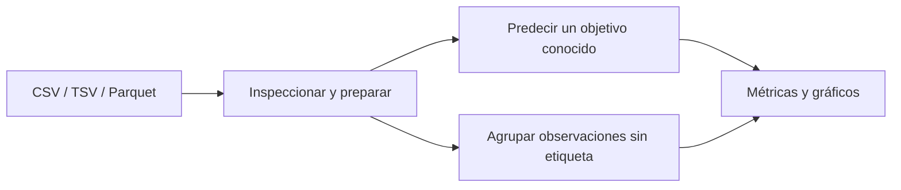
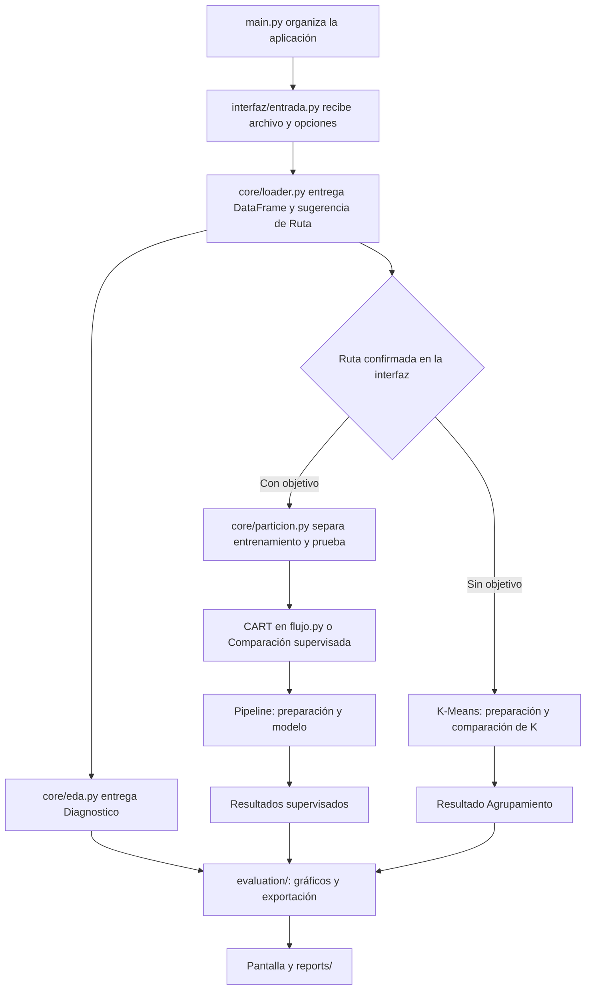
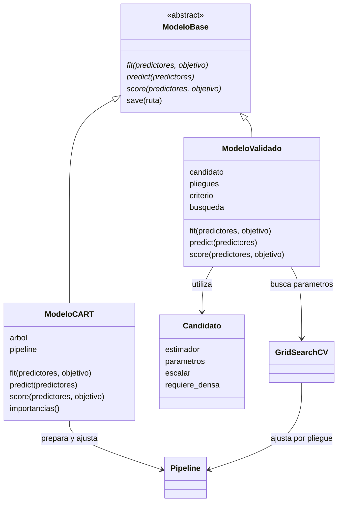
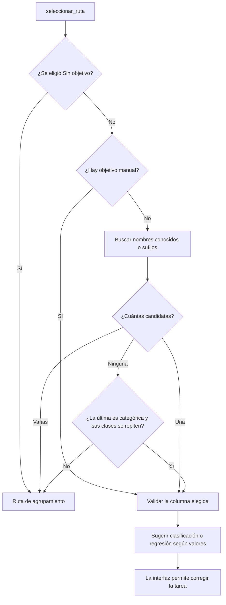
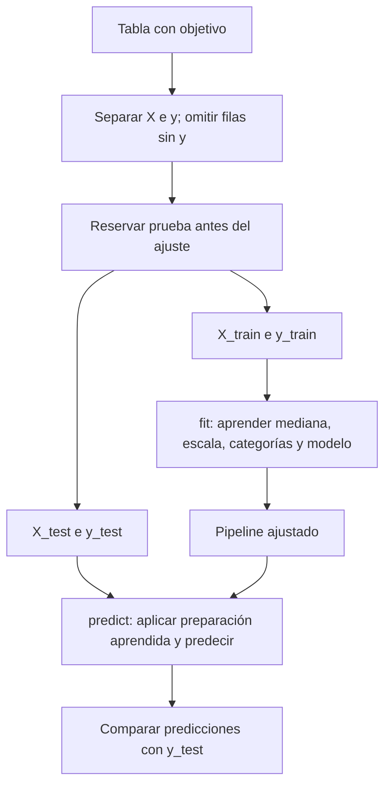
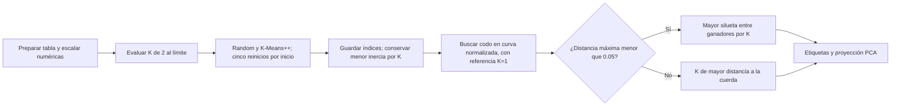

# Guía para preparar la presentación del sistema de Machine Learning

**Versión principal actual:** 9 láminas centradas en arquitectura, POO y recorrido del código, seguidas por dos demostraciones en la aplicación. El [PDF principal](entrega/penpot/Defensa_Miguel_Cortes.pdf) y las [notas del expositor](entrega/penpot/notas_expositor.txt) contienen el orden vigente. La versión ampliada queda como [apoyo para preguntas](entrega/penpot/Apoyo_tecnico_Miguel_Cortes.pdf).

El hilo de la presentación es seguir una tabla desde el archivo hasta un resultado que podamos interpretar. Cada etapa debe responder tres preguntas: **qué recibe, qué decide y qué entrega**. Así se puede explicar la arquitectura con ejemplos, sin recitar archivos ni memorizar párrafos.

Esta guía corresponde al código de la rama de práctica `practica/defensa-ml`, incluida la incorporación de F1 macro a la evaluación. Los textos «Cómo contarlo» son una base para ensayar con tus propias palabras. El contenido de apoyo al final se reserva para las preguntas; no hay que exponerlo completo en quince minutos.

Los diagramas están escritos en Mermaid. Un visor compatible los muestra como figuras; los bloques de texto y las tablas permiten seguir la explicación aunque el visor no los renderice.

**Para estudiarla sin abrumarte:** primero sigue las secciones 1, 4 y 6: vocabulario, recorrido y selección de ruta. Después estudia 7 y 8: EDA y preparación. Finalmente incorpora modelos, métricas y demostraciones. Para armar las diapositivas, toma de cada lámina el visual y su idea principal; conserva el resto como notas del expositor.

## 1 La historia que vas a contar

> Recibimos una tabla. Validamos su lectura y describimos sus propiedades. Sugerimos una tarea según el objetivo disponible, permitiendo corregir la interpretación. Preparamos las variables según el modelo. Luego entrenamos y evaluamos, o buscamos grupos si no hay etiquetas. Finalmente guardamos métricas, gráficos y configuración.

Antes de hablar de algoritmos, aclara este vocabulario con una tabla pequeña:

| Largo del pétalo | Ancho del pétalo | Clase |
|---:|---:|---|
| 1.4 | 0.2 | setosa |
| 4.7 | 1.4 | versicolor |
| 6.0 | 2.5 | virginica |

- Una **fila** es una observación.
- Las **variables predictoras**, llamadas X, aportan información: aquí largo y ancho.
- La **variable objetivo**, llamada y, es lo que queremos predecir: aquí la clase.
- Con y conocida podemos medir aciertos en filas reservadas: aprendizaje supervisado.
- Sin y podemos buscar observaciones parecidas: aprendizaje no supervisado.

Estas tres filas solo ilustran el vocabulario; no son suficientes para demostrar todo el entrenamiento del proyecto.

## 2 Distribución de los quince minutos

| Lámina o momento | Tiempo | Qué debe entender el público |
|---|---:|---|
| 1 Portada y propósito | 0:20 | Qué construimos |
| 2 Responsabilidades de los módulos | 0:55 | Arquitectura, cohesión y bajo acoplamiento |
| 3 Contrato, herencia y composición | 1:00 | Cómo se implementa POO |
| 4 Flujo de datos y funciones | 1:00 | Qué recibe y devuelve cada etapa |
| 5 Objetivo y tarea | 1:00 | Heurísticas y corrección manual |
| 6 Preparación y prevención de fuga | 1:10 | fit en entrenamiento y predict en prueba |
| 7 Extensibilidad con Candidato | 1:10 | Incorporar estimadores sin duplicar el flujo |
| 8 Validación del pipeline completo | 1:05 | Selección de parámetros dentro de entrenamiento |
| 9 Paso a la aplicación | 0:20 | Qué se demostrará en ambas rutas |
| Demostración supervisada en la app | 3:30 | Ejecutar e interpretar los errores |
| Demostración no supervisada y cierre en la app | 3:30 | Ejecutar, explicar K y contextualizar grupos |
| **Total** | **15:00** | |

Los apartados siguientes son material ampliado de estudio y apoyo; no representan una lámina obligatoria por apartado. EDA, métricas y resultados se muestran principalmente dentro de la aplicación.

Usa una idea principal por lámina. Incluye un diagrama o gráfico y pocas frases; las explicaciones extensas quedan en tus notas. Ensaya los tiempos con el computador de la demostración. El tiempo de ejecución también cuenta.

## 3 Problema y propósito

**Qué mostrar:** una tabla de entrada, una bifurcación entre predicción y agrupamiento y un ejemplo de reporte.



**Cómo contarlo:** «La herramienta reúne tareas que normalmente haríamos por separado: cargar, explorar, preparar, modelar y evaluar. La pregunta cambia según tengamos una respuesta conocida que queremos predecir o solo atributos con los que buscar grupos».

**Conexión con la pauta:** plataforma modular, datos tabulares y recorrido desde datos crudos hasta reportes.

## 4 Arquitectura y flujo de datos

**Qué mostrar:** el siguiente mapa. Las flechas representan el recorrido de datos y resultados, no una lista exacta de imports.



**Cómo contarlo:** «`main.py` organiza las vistas. La interfaz recoge decisiones; `core` prepara y describe datos; `models` implementa los métodos; `evaluation` calcula o presenta resultados. Podemos ejecutar el flujo de entrenamiento desde Python sin abrir la interfaz».

Explica los principios con ejemplos concretos:

| Principio | Significado sencillo | Ejemplo del proyecto |
|---|---|---|
| Alta cohesión | Las piezas de un módulo cumplen una responsabilidad relacionada | `loader.py` concentra lectura, validación y sugerencia de ruta |
| Bajo acoplamiento | Un cambio necesita afectar pocas piezas | Agregar F1 al evaluador alimenta las vistas y CSV que ya consumen su diccionario |
| Modularidad | Se pueden entender y usar responsabilidades por separado | El EDA recibe un DataFrame sin necesitar un widget de Streamlit |
| Extensibilidad | Se puede incorporar una variante sin duplicar todo el recorrido | Un `Candidato` nuevo reutiliza la preparación y búsqueda comunes |

**Código para respaldarlo:** [main.py](../main.py), [flujo.py](../flujo.py), [comparacion.py](../models/supervised/comparacion.py).

## 5 Clases y extensibilidad

**Qué mostrar:** un UML reducido y fiel a las relaciones principales.



**Cómo contarlo:** «La clase abstracta exige operaciones comunes. CART las implementa para un árbol; ModeloValidado las implementa para un modelo elegido por validación. El candidato describe lo específico de cada estimador y el flujo común se encarga del resto».

Explica **polimorfismo** como «poder llamar `fit` o `predict` a objetos con implementaciones diferentes siguiendo un contrato común». Explica **composición** como «construir un comportamiento utilizando otros objetos»: un modelo validado utiliza un candidato y una búsqueda que entrena pipelines.

No dibujes todos los algoritmos heredando de `ModeloBase`: no es lo que hace el código. LVQ1, DANN y el adaptador GAM siguen la interfaz de estimadores de scikit-learn y se integran por composición. K-Means tiene un flujo separado mediante `agrupar`.

**Código:** [base.py](../models/base.py), [tree_models.py](../models/supervised/tree_models.py), [candidato.py](../models/supervised/candidato.py).

## 6 Lectura y elección de ruta

### De archivo a tabla

```text
Nombre y bytes del archivo
        ↓
Extensión: CSV, TSV o Parquet
        ↓
Texto: UTF-8 con soporte BOM; alternativa Latin-1
CSV: separador explícito o inferido; TSV: tabulación por defecto
Parquet: lector binario
        ↓
Validación de filas, encabezados y existencia de datos
        ↓
DataFrame
```

El lector de texto comprueba que las filas tengan igual cantidad de campos. Los nombres se limpian de espacios en los extremos y se rechazan vacíos o repetidos. Sin encabezado se generan `columna_1`, `columna_2`, etc.

`Lectura` conserva la huella del contenido y las opciones de lectura. La interfaz calcula esa huella para reconocer si la tabla activa sigue siendo la misma.

### Elegir una columna objetivo y elegir una tarea son decisiones distintas

**Primero:** ¿qué columna queremos predecir? **Después:** ¿sus valores representan clases o una cantidad?



Si una candidata automática no tiene valores utilizables, se deriva a agrupamiento con explicación. Si se eligió manualmente una columna inválida, se informa el error para corregirla. El diagrama resume el recorrido normal; estas validaciones ocurren antes de aceptar la tarea.

**Reglas reales para encontrar el objetivo:**

1. Buscar nombres como `clase`, `target`, `objetivo` o sufijos `_target` y `_objetivo`, ignorando mayúsculas.
2. Con varias candidatas por nombre, explicar la ambigüedad y proponer agrupamiento.
3. Sin coincidencias por nombre, revisar la última columna: debe ser categórica y cumplir las reglas de repetición.
4. Sin una candidata clara, devolver `Ruta(None, AGRUPAMIENTO, motivo)` y mostrar una advertencia en el modo automático.

**Reglas reales para sugerir tarea:**

| Contenido del objetivo ya elegido | Sugerencia |
|---|---|
| Texto o booleanos | Clasificación |
| Números enteros finitos con pocas clases repetidas | Clasificación |
| Otros valores numéricos | Regresión; su ajuste requiere objetivos finitos |

«Pocas clases repetidas» significa entre 2 y `min(20, n // 3)` clases observadas, con al menos dos observaciones por clase; `n` cuenta los valores no faltantes. Esta regla se usa tanto para la última categórica como para los códigos enteros.

### Por qué se puede confundir y por qué existe el modo manual

| Ejemplo | Qué puede interpretar el programa | Qué aporta la persona |
|---|---|---|
| Última columna `ciudad`, con pocas ciudades repetidas | Puede sugerirla como objetivo | La ciudad podría ser solo un predictor; elegir el objetivo real o Sin objetivo |
| Columna `target` con valores 18, 19 y 20 muy repetidos | Puede sugerir clasificación por códigos enteros | Si es temperatura, seleccionar Regresión |
| Objetivo numérico `precio`, sin nombre reconocido ni sufijo | Puede no encontrar objetivo y proponer agrupamiento | Elegir manualmente `precio` |
| Columnas `clase` y `target` en el mismo archivo | Detecta ambigüedad | Elegir cuál responde a la pregunta del análisis |
| Tabla con una etiqueta, pero queremos explorar similitudes | Automático puede proponer supervisado | Elegir Sin objetivo y decidir si hay que retirar la etiqueta antes de agrupar |

En modo Sin objetivo se agrupan las columnas recibidas; no se elimina automáticamente una etiqueta existente. Si la conservas, puede influir en las distancias mediante su codificación.

**Cómo contarlo:** «Podemos reconocer patrones en nombres y valores, pero el archivo no contiene necesariamente la intención del análisis. Por eso mostramos el motivo de la sugerencia y permitimos cambiar tanto la columna objetivo como la tarea. Una regla automática ayuda a empezar; el contexto permite corregirla».

**Distinción importante:** se selecciona automáticamente una ruta; el entrenamiento comienza al pulsar el botón. La herramienta no busca automáticamente el objetivo que da más exactitud ni prueba todos los algoritmos al cargar.

**Código:** [loader.py](../core/loader.py), [entrada.py](../interfaz/entrada.py).

## 7 Qué nos dice el EDA

**Qué mostrar:** un mapa de correlación y una tabla corta de calidad. Utiliza figuras de la ejecución que vas a presentar, con nombres y ejes legibles.

| Diagnóstico | Pregunta que responde | Decisión que ayuda a evaluar |
|---|---|---|
| Faltantes y tipos | ¿Qué datos faltan y cómo están representados? | Imputación o revisión de lectura |
| Cardinalidad categórica | ¿Cuántas categorías distintas aparecen? | Tamaño de la codificación y posibles identificadores |
| Varianza y asimetría | ¿Hay constantes o distribuciones muy sesgadas? | Revisar utilidad y escala de variables |
| Regla IQR | ¿Qué valores están lejos de la zona central? | Inspección contextual de observaciones |
| Covarianza | ¿Cómo varían juntas dos variables en sus unidades? | Comparar dirección y magnitud en la escala original |
| Pearson | ¿Qué asociación lineal presentan? | Detectar pares potencialmente redundantes |
| Spearman | ¿Qué asociación presentan sus posiciones ordenadas? | Explorar relaciones monótonas |
| Dispersión | ¿Qué forma tiene la relación entre dos variables? | Ver grupos, tendencias y observaciones inusuales |

```text
IQR = Q3 − Q1
Límite inferior = Q1 − 1.5 × IQR
Límite superior = Q3 + 1.5 × IQR
```

**Cómo contarlo:** «El EDA entrega señales para investigar. Un dato fuera del IQR no es automáticamente un error y una correlación fuerte no demuestra causalidad. El programa informa estos hallazgos; no elimina esas filas o variables por su cuenta».

Los mapas incluyen hasta ocho variables y la tabla conserva la matriz completa. El EDA actual exporta covarianza, Pearson y Spearman. El listado destacado de la interfaz filtra Pearson positivo mayor que 0.85; el diagnóstico conserva también relaciones negativas y la dispersión toma el par de mayor magnitud absoluta.

**Código:** [eda.py](../core/eda.py), [exploracion.py](../interfaz/exploracion.py), [visualizer.py](../evaluation/visualizer.py).

## 8 Preparación y prevención de fuga de datos

**Qué mostrar:** dos caminos desde la partición. Destaca visualmente que prueba no participa en aprender las transformaciones.



**Cómo contarlo:** «Primero apartamos las preguntas del examen. Con entrenamiento aprendemos cómo completar faltantes, qué categorías existen y cómo escalar. En prueba aplicamos esas mismas reglas; no las recalculamos mirando las respuestas del examen».

La reserva es aproximadamente 20 %, redondeada hacia arriba, con mínimo de dos filas y ajustes por número de clases. En clasificación se estratifica; en regresión se exige un objetivo numérico finito. La semilla predeterminada es 42.

### Las dos ramas del preparador

```text
X de entrada
  ├─ Numéricas → infinitos a faltantes → mediana → escalado si corresponde
  └─ Categóricas → marcar ausencia → indicadores One-Hot
                       ↓
                Matriz para el modelo
```

- Una columna numérica vacía en entrenamiento se conserva con cero.
- Las categorías se aprenden en entrenamiento; una nueva en prueba produce ceros en los indicadores de esa columna.
- Escalar usa `z = (x − media_entrenamiento) / desviación_entrenamiento`.
- El catálogo activa escalado para logística, Ridge/Lasso, k-NN, LVQ1 y DANN. K-Means también lo activa. CART y Random Forest no lo necesitan para sus cortes habituales.
- Solo se estandariza la rama numérica; los indicadores categóricos también afectan las distancias y deben interpretarse según el dominio.

**Ejemplo para explicarlo:** si entrenamiento es `[2, faltante, 4]`, se aprende mediana 3. Si prueba contiene 1000, eso no cambia la mediana aprendida a partir de entrenamiento.

Durante CV se repite la misma separación dentro de cada pliegue: el pipeline completo se ajusta usando únicamente su porción de ajuste. Preparar una vez todo `X_train` antes de la CV filtraría información de validación hacia el ajuste de cada pliegue.

El EDA usa la tabla completa para describirla. Si usas los resultados de prueba observados para elegir variables o modelos, comprometes su independencia; las reglas de selección aprendidas deben incorporarse dentro del entrenamiento.

**Código:** [particion.py](../core/particion.py), [preprocessor.py](../core/preprocessor.py), `ModeloValidado.fit` en [comparacion.py](../models/supervised/comparacion.py).

## 9 Modelos y selección de hiperparámetros

**Qué mostrar:** agrupa los modelos por idea, en vez de enumerar imports.

| Familia | Idea sencilla | Tareas disponibles aquí | Qué se explora en la rejilla |
|---|---|---|---|
| Logística | Combinar variables para puntajes de clase | Clasificación | C: regularización inversa |
| Ridge y Lasso | Regresión lineal penalizada | Regresión | alpha: fuerza de penalización |
| CART y Random Forest | Cortes por umbral; combinación de árboles | Ambas | Profundidad |
| k-NN | Votar o promediar con vecinos, ponderando por distancia | Ambas | Número de vecinos |
| LVQ1 | Mover representantes de clase por atracción o repulsión | Clasificación | Tasa de aprendizaje |
| DANN | Adaptar distancias a la separación local de clases | Clasificación | Vecinos para votar |
| MARS | Construir y podar términos de bisagra | Regresión | Límite de términos |
| GAM | Sumar funciones suaves de los predictores | Regresión | Penalización de suavidad |

**Cómo contarlo:** «Cada familia declara un estimador, una rejilla y sus necesidades de preparación. La búsqueda común prueba sus configuraciones dentro del entrenamiento. Reservamos la prueba para evaluar los ajustes seleccionados».

```text
Entrenamiento
    ↓
Hasta cinco pliegues comunes a los candidatos
    ↓
Cada combinación: ajustar preparación y modelo → evaluar validación
    ↓
Elegir parámetros por promedio de validación
    ↓
Reajustar la mejor combinación con todo entrenamiento
    ↓
Evaluar en la misma prueba reservada para todas las familias
```

En clasificación se usa `StratifiedKFold` y se maximiza exactitud; en regresión se usa `KFold` y se maximiza MAE negativo, equivalente a minimizar MAE. El número de pliegues se reduce si los datos no permiten cinco. La rejilla de vecinos considera el tamaño mínimo de entrenamiento de los pliegues.

**Tres decisiones que no debes confundir:**

1. La ruta decide supervisado o agrupamiento.
2. La persona elige candidatos en Comparación; el catálogo ofrece los compatibles con la tarea.
3. La validación elige hiperparámetros de cada candidato. El reportador toma el mayor puntaje CV para los diagnósticos del modelo destacado.

El CART interactivo usa la profundidad elegida en pantalla; no ejecuta esa búsqueda. Su resultado puede diferir del CART de Comparación.

## 10 Cómo se elige K

**Qué mostrar:** curva de inercia anotada y gráfico de siluetas de una ejecución.



**Cómo contarlo:** «La inercia mide qué tan cerca quedan los puntos de sus centroides. Agregar grupos suele reducirla, así que no elegimos simplemente el mínimo. Buscamos dónde la mejora empieza a disminuir: normalizamos los ejes y medimos el alejamiento de la cuerda entre extremos. Si ese codo no queda definido por el umbral, usamos silueta».

| Índice | Lectura | Preferencia habitual |
|---|---|---|
| Inercia | Suma de distancias cuadráticas al centroide propio | Menor, considerando complejidad |
| Silueta | Cercanía al grupo propio frente al grupo alternativo más cercano | Mayor; rango de −1 a 1 |
| Calinski-Harabasz, CHI | Dispersión entre grupos relativa a la interna | Mayor |
| Davies-Bouldin, DBI | Semejanza relativa entre grupos según dispersión y separación | Menor |

CHI y DBI se calculan para comparar, pero no votan automáticamente en la regla actual de selección. K=1 solo aporta referencia de inercia. El límite efectivo de K respeta el número de filas y observaciones distintas.

**PCA viene después del agrupamiento.** Se ajustan los grupos en todas las variables preparadas y luego se proyectan puntos y centroides sobre los mismos ejes. En dos dimensiones puede perderse separación que existía en el espacio completo.

**Código:** [kmeans_engine.py](../models/unsupervised/kmeans_engine.py).

## 11 Métricas y reportes

| Ruta | Qué mostrar | Interpretación que debes dar |
|---|---|---|
| Clasificación | Exactitud, F1 macro y matriz normalizada | Cuántos aciertos y cómo se reparten los errores por clase |
| Comparación clasificadora | ROC/AUC, Precision-Recall y aprendizaje | Orden de puntajes por umbral y comportamiento según tamaño o hiperparámetro |
| Regresión | MAE, RMSE, R², reales frente a predichos y residuales | Magnitud del error, casos grandes y patrones de desviación |
| Agrupamiento | Inercia, siluetas, CHI, DBI y PCA | Compacidad y separación sin una etiqueta verdadera de referencia |

**Cómo contarlo:** «El gráfico y las métricas responden preguntas distintas. Una exactitud alta puede ocultar una clase mal reconocida; por eso miramos la matriz por clase. En agrupamiento no tenemos respuestas conocidas: evaluamos geometría e interpretamos los perfiles de los grupos».

Las figuras se guardan como PNG a 300 DPI. Una ejecución puede exportar CSV de métricas, JSON de configuración y parámetros, curvas por clase y asignaciones de grupos según el flujo. La configuración registra huella del archivo, lectura y semilla; los nombres de modelos y sus parámetros permiten identificar lo ejecutado. Para repetirlo también deben conservarse datos y versiones.

La banda de regresión actual es un IC puntual del 95 % para la media de una recta de calibración. No es un intervalo de predicción de futuras observaciones. La superficie de clasificación se genera con exactamente dos predictores numéricos originales con variación.

**Ejemplo del primer ejercicio:** agregar F1 macro en `evaluar_supervisado` amplió el diccionario que consumen pantalla y exportación. La búsqueda sigue seleccionando por exactitud: informar una métrica y optimizarla son decisiones distintas.

**Código:** [metrics.py](../evaluation/metrics.py), [reportes.py](../evaluation/reportes.py), [exportacion.py](../evaluation/exportacion.py).

## 12 Demostración supervisada con defectos de acero

**Pregunta del dominio:** ¿podemos distinguir tres tipos de defectos ya detectados usando área y luminosidad? El ejercicio no evalúa si una placa está sana o defectuosa.

**Datos:** `defectos_acero.csv`, 518 filas; predictores `log_area_px` e `indice_luminosidad`; objetivo `clase`. La procedencia y el recorte están documentados en [los flujos con datos reales](FLUJOS_Y_RESULTADOS_DATASETS_REALES.md).

| Acción en vivo | Qué explicar mientras la haces |
|---|---|
| Abrir el archivo con Automática | «Reconoce `clase` por nombre y propone clasificación por su contenido» |
| Mostrar Variables y una relación | «Revisamos calidad y escalas antes de entrenar; los atípicos se informan, no se borran» |
| Ejecutar CART con profundidad 3 | «Se reserva prueba antes de ajustar el preparador y el árbol» |
| Mostrar matriz normalizada | «Cada fila corresponde a una clase real; la diagonal indica recall de esa clase» |
| Mostrar importancias | «Esto resume los cortes del árbol; no prueba causalidad» |
| Mostrar un reporte de Comparación | «Los parámetros se eligen por CV; ROC y PR usan puntajes sobre prueba» |

Con semilla 42 y profundidad 3, la referencia verificada es **414 filas de entrenamiento, 104 de prueba y 99 aciertos**, una exactitud de aproximadamente **95.2 %** y F1 macro de **0.907**. Predecir siempre Raya K acertaría 79 de 104, aproximadamente 76.0 %.

**Interpretación para decir:** «El árbol supera la referencia mayoritaria, pero debemos mirar las clases pequeñas. Acertó 9 de 11 casos de suciedad, frente a 77 de 79 rayas K. La evidencia para suciedad es reducida; conviene revisar sus confusiones y probar con lotes nuevos antes de proponer un uso operativo».

No llenes la lámina con todas las métricas de todos los modelos. Elige una matriz y una curva que puedas interpretar. Ten la Comparación calculada en su vista para consultarla; si la ejecutas en vivo, incluye su tiempo en el ensayo.

## 13 Demostración no supervisada con sismos

**Pregunta del dominio:** ¿qué perfiles aparecen al agrupar eventos por ubicación, profundidad y magnitud?

**Datos:** `sismos_profundos_pacifico.tsv`, 250 eventos y cuatro atributos. La magnitud es una característica más del agrupamiento; el archivo no trae una etiqueta objetivo designada. Consulta [el contexto y la preparación geográfica](FLUJOS_Y_RESULTADOS_DATASETS_REALES.md) antes de explicar las coordenadas.

| Acción en vivo | Qué explicar |
|---|---|
| Abrir el TSV con Automática | «No encuentra una candidata clara; explica el motivo y propone agrupamiento» |
| Mostrar las cuatro columnas | «Usamos todas estas propiedades, con escalado de las numéricas» |
| Evaluar hasta K=8 | «Comparamos dos inicializaciones y calculamos los índices por K» |
| Mostrar Codo y Siluetas | «La selección es una regla explícita, que puede diferir del máximo de otro índice» |
| Mostrar Proyección | «PCA ayuda a visualizar; no fue el espacio en el que se decidió el agrupamiento» |
| Mostrar descarga de asignaciones | «Las etiquetas permiten volver a las variables originales y describir cada grupo» |

La referencia verificada es **K=5**, con silueta media aproximada de **0.392**. Para K=6, la solución de menor inercia tiene silueta aproximada de **0.402**. Se elige cinco por el codo; seis es una alternativa que merece contraste.

**Interpretación para decir:** «Los grupos resumen similitudes en este recorte de eventos. Por ejemplo, un grupo reúne eventos relativamente menos profundos y otro contiene solo cuatro observaciones. Debemos revisar esos perfiles en sus unidades originales. Los grupos no demuestran estructuras tectónicas ni sirven por sí solos para pronosticar sismos».

Los identificadores de grupo son arbitrarios; “grupo 1” no significa menor magnitud ni mayor riesgo.

Si el docente pide otro dataset, conserva el mismo recorrido: pregunta del análisis, variables, calidad, ruta, preparación, ejecución e interpretación. Como alternativa local rápida están `iris_petalos.csv` para clasificación e `iris_medidas.tsv` sin etiqueta.

## 14 Conclusiones y límites

**Qué mostrar:** tres afirmaciones concretas y un límite.

- Separamos interfaz, tratamiento de datos, estimadores y reportes.
- Ajustamos preparación y modelos respetando la reserva y los pliegues de entrenamiento.
- Explicamos la ruta elegida y exportamos evidencia para interpretar cada ejecución.
- La detección de objetivo es heurística y la utilidad de los resultados depende del contexto y de validación adicional.

**Cómo contarlo:** «La contribución del proyecto es integrar el recorrido de forma reutilizable y hacer visibles sus decisiones. La corrección manual del objetivo y los reportes ayudan a revisar esas decisiones. La evaluación con datos reservados o los índices de agrupamiento aportan evidencia dentro de sus límites».

## 15 Apoyo para preguntas sobre el estado y los datos

No hace falta dedicar una lámina principal a cada objeto, pero debes poder seguir sus nombres en el código:

| Objeto | Qué representa | Qué no debes confundir |
|---|---|---|
| `Lectura` | Huella y opciones de lectura | No contiene el DataFrame |
| `tabla` | Datos originales ya leídos | No es la matriz transformada para el modelo |
| `Ruta` | Objetivo, tarea y motivo | No es un modelo ajustado |
| `Diagnostico` | Tablas del EDA | No ejecuta selección automática de predictores |
| `Particion` | X/y de entrenamiento y prueba, con filas alineadas | Prueba no se usa para seleccionar parámetros |
| `Candidato` | Estimador, rejilla y opciones de preparación | Todavía no es el ganador entrenado |
| `ResultadoCART` o `Comparacion` | Ajustes y evaluación supervisados | Métrica CV y métrica de prueba provienen de conjuntos distintos |
| `Agrupamiento` | K, índices, etiquetas y centroides proyectados | Los centroides devueltos aquí están en coordenadas PCA |
| `Publicacion` | Resultado y rutas de archivos | No constituye una nueva ejecución al mostrarlo |

Streamlit reejecuta el script al interactuar. `EstadoAnalisis` identifica el contexto por lectura, objetivo y tarea. `EstadoVista` conserva opciones y publicación; si cambian parámetros, descarta el resultado anterior. Los botones controlan cuándo se entrena. Esto evita mostrar un resultado calculado con una configuración distinta de la vigente.

Las rutas se construyen desde la ubicación del proyecto con `Path(__file__).resolve().parent`, no con un directorio personal escrito a mano. Que `resolve()` produzca una ruta absoluta en ejecución no significa que exista una ruta local fija incrustada en el código.

## 16 Apoyo matemático para DANN y LVQ1

### DANN y la contracción de índices

La expresión actual es:

```python
distancias = np.sum((diferencias @ metrica) * diferencias, axis=1)
```

Si hay `n` filas y `p` predictores transformados:

```text
diferencias:              n × p
metrica:                 p × p
diferencias @ metrica:    n × p
producto elemento a elemento: n × p
suma por columnas de cada fila: n resultados
```

Cada resultado es `d_iᵀ M d_i`, con `d_i = x_i − x_consulta`. Equivale a:

```python
np.einsum("ij,jk,ik->i", diferencias, metrica, diferencias)
```

`i` identifica observaciones y permanece en la salida; `j` y `k` identifican coordenadas y se suman. Analíticamente es `Σ_j Σ_k d[i,j] M[j,k] d[i,k]`. Con `d=[1,2]` y `M=diag(2,0.5)`, el resultado es 4.

DANN estima una dispersión interna W y una separación entre clases B en un entorno euclidiano de la consulta. El código usa `A=(W+10⁻⁵I)⁻¹` y `M=A B A + epsilon A`. La regularización permite resolver el sistema con predictores redundantes. La métrica es local y se recalcula para cada consulta; no es simplemente la matriz de covarianza global.

**Qué dibujar:** dos clases alargadas, una vecindad circular euclidiana y una elíptica que representa otra ponderación de direcciones. Explica que el dibujo es conceptual y que el código define la deformación mediante M.

### LVQ1 y la atracción o repulsión

```text
w_nuevo = w + signo × tasa_actual × (x − w)
signo = +1 si la clase coincide; −1 si no coincide
```

Se elige el prototipo más cercano y se lo mueve hacia el punto si acierta su clase, o en dirección opuesta si se equivoca. Aquí hay un prototipo por clase, inicializado en su media. La tasa decrece por época.

Con `w=[0,0]`, `x=[2,4]` y tasa `0.1`, atracción da `[0.2,0.4]`; repulsión da `[-0.2,-0.4]`. Los puntajes de cercanía de LVQ y las proporciones de votos de DANN no garantizan probabilidades calibradas.

**Práctica:** cada integrante debería deducir ambos cálculos en papel y ubicar las líneas en [prototype_models.py](../models/supervised/prototype_models.py).

## 17 Cómo demostrar cada dimensión de la rúbrica

| Dimensión | Peso | Evidencia para la exposición | Preparación adicional |
|---|---:|---|---|
| Arquitectura, POO y escalabilidad | 10 % | Mapa de módulos, UML y registro de un candidato | Mostrar contrato, composición y rutas portables |
| EDA y preprocesamiento | 10 % | Heatmaps, calidad y diagrama sin fuga | Explicar estadísticas de entrenamiento y CV |
| Modelado supervisado y K-Means | 10 % | Familias, búsqueda y regla de K | Justificar modelos especializados y sus parámetros |
| Métricas y visualización | 10 % | Matriz, ROC/PR, siluetas y PCA legibles | Interpretar unidades, ejes y alcance de la banda de regresión |
| Informe y rigor conceptual | 10 % | Resultados contextualizados y UML consistente | Informe de hasta 15 páginas, ecuaciones y procedencia de datos |
| Defensa y código en vivo | 50 % | Dos ejecuciones y explicación de decisiones | Cambio en menos de cinco minutos y derivación de operaciones |

La presentación apoya los entregables, pero no reemplaza el informe, README, dependencias fijadas ni historial Git verificable. Antes de entregar, alinea los nombres de clases, parámetros, resultados y UML entre código, informe y láminas.

No prometas ingesta o detección infalibles. El lector soporta formatos y reglas concretas; hay tablas que se pueden leer pero no modelar por falta de filas, clases o variación. Extender el catálogo es una forma de escalabilidad arquitectónica; no demuestra por sí sola capacidad para datasets enormes. La silueta puede tener costo cuadrático y densificar muchas categorías también consume memoria.

## 18 Preparación de la demostración y del cambio en vivo

Desde la raíz y con las dependencias instaladas:

```bash
source .venv/bin/activate
python -m streamlit run main.py
```

Antes de exponer:

1. Ejecuta ambos datasets en el computador de la presentación y verifica los reportes nuevos.
2. Comprueba que la Comparación y sus gráficos quepan en el tiempo disponible. Conserva capturas de respaldo de esas ejecuciones por si falla la interfaz; identifica cuándo muestras un resultado previo.
3. Abre en el editor `loader.py`, `preprocessor.py`, `comparacion.py`, `prototype_models.py` y `metrics.py`.
4. Ensaya explicar una confusión de target y corregirla desde la interfaz.
5. Practica un cambio pequeño: F1 macro, rejilla CART o selección de K por silueta, siguiendo [la guía de ejercicios](PRACTICA_CAMBIOS_EN_VIVO.md).
6. Comprueba que el reporte muestre la configuración realmente ejecutada y que no estés leyendo un archivo de una corrida anterior.

Para cada modificación, habla en este orden: **qué cambia → dónde vive esa responsabilidad → cómo viaja el valor → cómo compruebo el efecto**. Para una pregunta conceptual, usa: **decisión → razón → ejemplo → límite**.

Ejemplo: «Detectamos objetivos por reglas de nombres y contenido. Eso permite comenzar sin configurar todo. Una temperatura entera repetida puede parecer código de clase. La persona puede mantener esa columna y corregir la tarea a regresión».

## 19 Preguntas para comprobar que puedes explicar la presentación

Respóndelas mirando primero los diagramas y después buscando la función correspondiente:

1. ¿Qué diferencia hay entre objetivo, tarea, candidato e hiperparámetro?
2. ¿Qué devuelve `cargar_tabla` y qué devuelve `seleccionar_ruta`?
3. ¿Por qué dos columnas llamadas `clase` y `target` generan ambigüedad?
4. ¿Por qué no elegimos siempre la última columna numérica como objetivo?
5. ¿En qué situación conservarías el objetivo sugerido, pero cambiarías la tarea?
6. ¿Dónde se retira el objetivo de los predictores?
7. ¿Qué se aprende en `fit` del preprocesador y qué pasa en prueba?
8. ¿Por qué el preparador está dentro de la búsqueda de CV?
9. ¿Todos los estimadores heredan de `ModeloBase`?
10. ¿Por qué agregar F1 al reporte no cambia los hiperparámetros seleccionados?
11. ¿Qué diferencia hay entre el CART interactivo y el del catálogo?
12. ¿Cómo puede K=5 ser elegido si K=6 tiene mayor silueta?
13. ¿La visualización PCA fue la entrada de K-Means?
14. ¿Qué conclusión permite una matriz de confusión y cuál requiere más datos?
15. ¿Qué evidencia mostrarías si el docente dice «demuestra que tu cambio llegó al modelo»?

Si una respuesta necesita demasiadas palabras, vuelve al ejemplo de una tabla pequeña y sigue el dato de entrada hasta el resultado. Ese recorrido es la base para explicar y modificar el proyecto con claridad.
